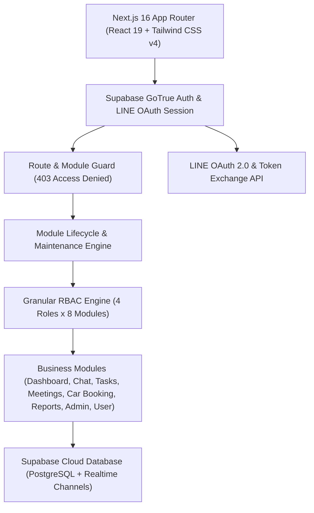

# 🏢 Smart MSO — ระบบออฟฟิศเสมือนสำหรับหน่วยงานภาครัฐและองค์กร (Virtual Office)

ระบบสื่อสาร ทำงานร่วมกัน และบริหารจัดการทรัพยากรภายในองค์กรและหน่วยงานราชการ พัฒนาด้วย **Next.js 16 (App Router)**, **React 19**, **TypeScript** และ **Tailwind CSS v4** เชื่อมต่อฐานข้อมูลคลาวด์สด **Supabase PostgreSQL & Supabase Auth** พร้อมระบบยืนยันตัวตนผ่าน **Google OAuth** และ **LINE Login SSO**, สถาปัตยกรรมการจัดการสิทธิ์ขั้นสูง (**Granular Role-Based Access Control - RBAC**), ระบบบริหารคำขอสิทธิ์เข้าใช้งานใหม่ (Access Requests E-Workflow) และโครงสร้างข้อมูลบุคลากรตามระเบียบงานสารบรรณภาครัฐ

> 🌐 **Production URL:** [https://www.smso.site](https://www.smso.site)  
> 📘 **คู่มือการพัฒนาและสถาปัตยกรรมระบบ (Developer Handbook):** [docs/DEVELOPMENT_HANDBOOK.md](file:///c:/Users/GuitarDev/virtual-office/docs/DEVELOPMENT_HANDBOOK.md)  
> 🏛️ **บันทึกการพัฒนาฉบับรวมสมบูรณ์ (Master Work Log):** [docs/work-log-master.md](file:///c:/Users/GuitarDev/virtual-office/docs/work-log-master.md)

---

## 🌟 ภาพรวมระบบและฟีเจอร์เด่น (Key Features)

- 🟢 **Live Supabase Backend & Realtime Synchronization:**
  - เชื่อมต่อโครงการ Supabase Live จริง (`xkeiuyhkokmecefzzynb.supabase.co`) จัดเก็บตาราง `users` และ `access_requests`
  - ระบบ Realtime Subscription (`postgres_changes`) ซิงก์ข้อมูลบุคลากรและคำขอแบบสดผ่าน WebSocket โดยไม่ต้องรีเฟรชหน้าจอ
  - แสดงสถานะเชื่อมต่อสด `🟢 Supabase Live` พร้อมระบบตัดสลับ In-Memory Fallback อัตโนมัติเมื่อออฟไลน์
- 💬 **LINE Login SSO & Google OAuth 2.0 (OpenID Connect):**
  - เข้าสู่ระบบด้วยบัญชี **LINE Account** สีทางการ (`#06C755`) ด้วย OAuth 2.0 / OpenID Connect
  - มี API Route ฝั่งเซิร์ฟเวอร์ [`/api/auth/line/exchange`](file:///c:/Users/GuitarDev/virtual-office/app/api/auth/line/exchange/route.ts) และ [`/api/auth/line/callback`](file:///c:/Users/GuitarDev/virtual-office/app/api/auth/line/callback/route.ts) สำหรับแลกเปลี่ยน Token กับ LINE API อย่างปลอดภัย
  - ระบบซิงก์รูปโปรไฟล์ (Avatar), ชื่อผู้ใช้ และ User ID จาก LINE เข้าสู่ระบบอัตโนมัติ
  - จัดการคำนำหน้าชื่อ (Prefix) อัจฉริยะ: ไม่บันทึก "นาย/นางสาว" โดยอัตโนมัติ เว้นว่างหรือดึงคำนำหน้าจริง และอนุญาตให้ระบุคำนำหน้าทางการ (นาย, นาง, นางสาว, ดร., ว่าที่ ร.ต.) ได้เองในหน้าข้อมูลส่วนตัว
- 🔐 **Supabase Authentication Suite:**
  - เข้าสู่ระบบและลงทะเบียนด้วย Email & Password จริงผ่าน GoTrueClient
  - ระบบกู้คืนและส่งอีเมลรีเซ็ตรหัสผ่าน (`sendPasswordResetEmail`)
  - กลไก **Smart Directory Bypass** สำหรับเจ้าหน้าที่ในทำเนียบข้าราชการเดิม
  - กฎหมายคุ้มครองข้อมูลส่วนบุคคล (PDPA): มีหน้านโยบายความเป็นส่วนตัว [`/policy`](file:///c:/Users/GuitarDev/virtual-office/app/policy/page.tsx) และข้อกำหนดการใช้งาน [`/term`](file:///c:/Users/GuitarDev/virtual-office/app/term/page.tsx)
- 📬 **ระบบจัดการคำขอสิทธิ์เข้าใช้งานใหม่ (Access Requests E-Workflow):**
  - แบบฟอร์มขอสิทธิ์ใช้งานสำหรับบุคคลภายนอก/ข้าราชการบรรจุใหม่บนหน้า Login
  - แท็บ **"คำขอสิทธิ์เข้าใช้งานใหม่"** ในหน้า Admin พร้อมกระดิ่งแจ้งเตือนและ Badge แสดงจำนวนคำขอรอตรวจสอบ
  - ระบบอนุมัติ (Approve) บรรจุเข้าทำเนียบและกำหนด Role ทันที หรือปฏิเสธ (Reject) พร้อมบันทึกเหตุผลและ Audit Log
- 🏛️ **Government Personnel Directory:** โครงสร้างข้อมูลข้าราชการ/เจ้าหน้าที่รัฐครบถ้วน (คำนำหน้า, ชื่อ, นามสกุล, ชื่อเล่น `nickname`, ตำแหน่ง, กลุ่ม/ฝ่าย, อีเมล `@m-society.go.th`, เบอร์โต๊ะทำงาน, Line ID) พร้อมข้อมูลจำลองจากทำเนียบบุคลากรจริงของ **พมจ.กำแพงเพชร**
- 👥 **Full Personnel Management (Admin CRUD):**
  - 👁️ ดูแฟ้มข้อมูลประวัติข้าราชการฉบับสมบูรณ์ (Dossier Modal)
  - ✏️ แก้ไขข้อมูลส่วนบุคคล ตำแหน่ง ฝ่าย และบทบาทสิทธิ์ พร้อมระบบ Dynamic Session Auto-sync
  - 🗑️ ลบบุคลากรพร้อมระบบความปลอดภัย 2 ชั้น: ป้องกันการลบผู้บริหารสูงสุด (`usr_1`) และป้องกันการลบบัญชีตนเองขณะล็อกอิน
  - ➕ ลงทะเบียนบุคลากรใหม่เข้าสู่ระบบ
- 🎛️ **System Module Controls & Maintenance Engine:**
  - สวิตช์เปิด/ปิด แต่ละโมดูลระดับระบบแบบเรียลไทม์
  - หน้าจอ **🚧 ปิดปรับปรุงชั่วคราว (Maintenance Screen)** สำหรับผู้ใช้ทั่วไป พร้อม Badge กำกับบน Sidebar
  - แบนเนอร์ **👑 Admin Bypass Override Mode** ให้ผู้ดูแลระบบเข้าตรวจสอบและกดเปิดใช้งานโมดูลได้ทันที
  - กลไกป้องกันการปิดระบบโมดูล Admin Console
- 🛡️ **Enterprise RBAC & Security:** 4 ระดับบทบาท (Admin 👑, Manager 👔, Member 👤, Guest 🎟️), ตารางเมทริกซ์กำหนดสิทธิ์แบบ Live, ระบบ Route Guard 403 Forbidden และ Security Audit Logs

---

## 🏛️ สถาปัตยกรรมระบบ (System Architecture)



---

## 🗺️ แผนผังการพัฒนาต่อเนื่อง (Roadmap Overview)

| เฟส (Phase) | ชื่อเฟส | รายละเอียดหลัก | สถานะ |
|:---:|---|---|:---:|
| **Phase 1** | Prototyping & Design Foundation | 8 โมดูลหลัก, ดีไซน์โทนสี Indigo/Teal/Slate, ฟอนต์ Kanit/Sarabun | ✅ สมบูรณ์ |
| **Phase 2** | Next.js 16 & Tailwind CSS v4 | สถาปัตยกรรม App Router, React 19, TypeScript, Dark Theme Toggle | ✅ สมบูรณ์ |
| **Phase 3** | Enterprise RBAC System | 4 บทบาทหลัก, ตารางเมทริกซ์สิทธิ์, Role Simulator, Route Guard 403 | ✅ สมบูรณ์ |
| **Phase 4** | Enterprise Auth & Sessions | Split-Screen Login, 1-Click Quick Demo, Session Persistence, Logout Modal | ✅ สมบูรณ์ |
| **Phase 5** | Government Schema & Directory | คำนำหน้า, ชื่อ, นามสกุล, ชื่อเล่น (`nickname`), ฝ่าย, ข้อมูลจริง พมจ.กำแพงเพชร | ✅ สมบูรณ์ |
| **Phase 6** | Admin Personnel CRUD Suite | ดูแฟ้มประวัติ, แก้ไขข้อมูล, ลบสมาชิก, ป้องกันการลบ Root Admin & บัญชีตนเอง | ✅ สมบูรณ์ |
| **Phase 7** | System Module Controls | สลับเปิด/ปิดโมดูลเรียลไทม์, Maintenance Screen, Admin Bypass Override | ✅ สมบูรณ์ |
| **Phase 8** | **Synology NAS Sovereign Storage** | คลังเอกสาร DMS (`/files`) & Synology Photos (`/gallery`), Direct Client Upload, Cloudflare Tunnel | ✅ สมบูรณ์ |
| **Phase 9** | **Government Fleet & Word .docx** | ขอใช้รถราชการ, เกจวัดน้ำมันแอนะล็อก, แจ้งเตือนคืนรถ, สร้างเอกสาร Word A4 หน้าเดียว (คข-69_009) | ✅ สมบูรณ์ |
| **Phase 10** | **Meetings & Room Booking Suite** | ผังเวลาห้องประชุม 6 ห้อง, จองห้อง 1 คลิก, ปฏิทินรายเดือน พ.ศ., ตาราง Supabase `meeting_rooms` | ✅ สมบูรณ์ |
| **Phase 11** | **E-Circular Multi-Attachment** | หนังสือเวียนตราครุฑมาตรฐาน, แนบหลายไฟล์พร้อมพรีวิวแยกอิสระ, ลงนามดิจิทัล, Circulation Slip | ✅ สมบูรณ์ |
| **Phase 12** | **Tasks & Kanban 8 Missions & LINE** | กระดาน 8 กลุ่มภารกิจ พมจ.กำแพงเพชร, Deadline Intelligence วันที่ พ.ศ., ฟอร์แมตส่งเข้ากลุ่ม LINE | ✅ สมบูรณ์ |
| **Phase 13** | **Kamphaeng Phet Social Data Hub** | สถิติจริง 11 อำเภอ, 5 มิติ TPMAP, ส่งออก Excel ภาษาไทย, พิมพ์รายงานทางการ กบจ. พร้อมตราครุฑ/พมจ. | ✅ สมบูรณ์ |
| **Phase 14** | **Authentic Office Directory & Chat** | ทำเนียบบุคลากรจริง 11 ท่าน พมจ.กำแพงเพชร, ซิงก์ห้องแชทประจำฝ่าย, ข้อความเริ่มต้นราชการ | ✅ สมบูรณ์ |
| **Phase 15** | **Smart Civil-Service Tools** | เครื่องมือตัดขอบและเปลี่ยนสีพื้นหลังรูปติดบัตรข้าราชการ (`/tools/bgremove`), ตัวสร้าง QR Code ถาวร | ✅ สมบูรณ์ |

---

## 🏛️ 13 โมดูลและเส้นทางระบบ (All 13 System Routes)

| เส้นทาง (Route) | ชื่อโมดูล | รายละเอียดและความสามารถหลัก |
|:---|:---|:---|
| `/` & `/dashboard` | **หน้าแรก (Dashboard)** | ภาพรวมสำนักงาน, ตัวชี้วัด TPMAP, หนังสือเวียนด่วน, แจ้งเตือนฉุกเฉิน |
| `/circular` | **หนังสือเวียน (Circular)** | เวียนหนังสือราชการตราครุฑ, แนบหลายไฟล์, พรีวิวอิสระ, ลงนามและพิมพ์ใบสรุป |
| `/tasks` | **ภารกิจงาน (Tasks)** | กระดาน Kanban 8 กลุ่มภารกิจ พมจ.กำแพงเพชร, แจ้งเตือนส่งงาน, แชร์เข้า LINE |
| `/meetings` | **การประชุม (Meetings)** | ปฏิทินนัดหมายรายเดือน พ.ศ., จองห้องประชุม 6 ห้อง, ตรวจสอบผังเวลาว่าง |
| `/chat` | **แชททีม (Chat)** | แชทกลุ่มทางการแยกฝ่าย, ซิงก์ทำเนียบบุคลากรจริง, แนบเอกสารและเก็บลง NAS |
| `/carbooking` | **รถราชการ (Car Booking)** | ขอใช้รถ, เกจวัดน้ำมัน, คนขับ, เตือนส่งคืนรถ, ส่งออกไฟล์ Word .docx หน้าเดียว |
| `/data-hub` | **ศูนย์รวมข้อมูล (Data Hub)** | สถิติ 11 อำเภอ, 5 มิติ TPMAP, รายงาน กบจ., ทำเนียบบุคลากร พมจ.กำแพงเพชร |
| `/files` | **เอกสาร NAS (File Station)** | คลังเอกสาร DMS บน Synology NAS, กรองประเภทไฟล์, กรองปีงบประมาณ พ.ศ. |
| `/gallery` | **ภาพ & สื่อ (Synology Photos)** | คลังภาพกิจกรรมโครงการ, อัลบั้ม, ไทม์ไลน์, Lightbox EXIF, ซิงก์ NAS |
| `/reports` | **รายงาน (Reports)** | รายงานสถิติการใช้งานระบบ, การใช้รถราชการ และดาวน์โหลดสรุป |
| `/tools/bgremove` | **BG Remove** | เครื่องมือตัดขอบและเปลี่ยนสีพื้นหลังภาพถ่ายติดบัตรข้าราชการด้วย Canvas |
| `/tools/qrcode` | **QR Code** | เครื่องมือสร้าง QR Code คุณภาพสูงสำหรับติดเอกสารและประกาศราชการ |
| `/admin` | **จัดการระบบ (Admin Panel)** | แฟ้มประวัติบุคลากร, เมทริกซ์กำหนดสิทธิ์ RBAC, คำขอสิทธิ์ใหม่, สวิตช์เปิด/ปิดระบบ |
| `/user` | **ข้อมูลส่วนตัว (Profile)** | โปรไฟล์ผู้ใช้, ข้อมูลสังกัด, ช่องทางติดต่อ และการตั้งค่าความปลอดภัย |

---

## 🧪 การตรวจสอบคุณภาพโค้ดและการทดสอบอัตโนมัติ (Verification & Playwright)

```bash
# ตรวจสอบ TypeScript Type Checking แบบ Strict (0 Errors)
npx tsc --noEmit

# รันชุดทดสอบ Playwright หลักทั้งหมด (24 การทดสอบ ผ่าน 100%)
npx playwright test tests/division-chat.spec.ts tests/datahub-social-stats.spec.ts tests/circular-multi-attachment.spec.ts tests/tasks-mission-line.spec.ts tests/nas-dms-gallery.spec.ts

# ทดสอบคอมไพล์ Production Bundle สมบูรณ์ทุก Route
npm run build
```

*สถานะการทดสอบ:* ผ่านการตรวจสอบ Type Check 100% (0 errors), Build Production สำเร็จใน < 1 วินาที และผ่านการทดสอบ User Flows อัตโนมัติด้วย Playwright

---

## 👤 คณะผู้ดูแลโครงการ

- 💻 **Lead Developer:** GuitarDev
- 🏛️ **หน่วยงานต้นแบบ:** สำนักงานพัฒนาสังคมและความมั่นคงของมนุษย์จังหวัดกำแพงเพชร (พมจ.กำแพงเพชร)
- 🔒 **มาตรฐาน:** Enterprise Role-Based Access Control & Government Electronic Workflow
- 🌐 **Deploy Production:** [https://www.smso.site](https://www.smso.site)
- 📖 **เอกสารฉบับสมบูรณ์:** [docs/README.md](file:///c:/Users/GuitarDev/virtual-office/docs/README.md)
