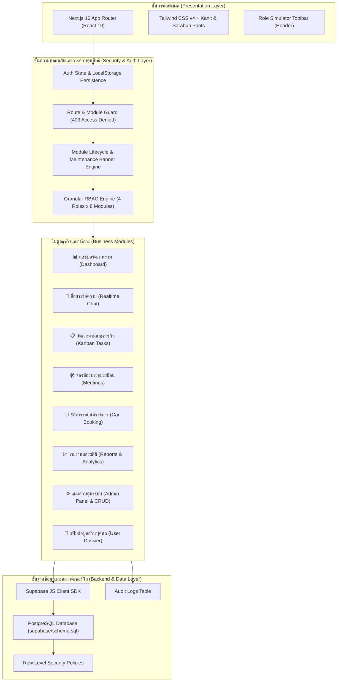
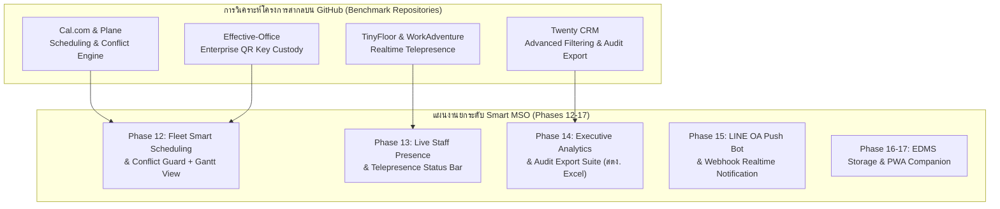

# 🏢 Smart MSO — ระบบออฟฟิศเสมือนสำหรับหน่วยงานภาครัฐและองค์กร (Virtual Office)

ระบบสื่อสาร ทำงานร่วมกัน และบริหารจัดการทรัพยากรภายในองค์กรและหน่วยงานราชการ พัฒนาด้วย **Next.js 16 (App Router)**, **React 19**, **TypeScript** และ **Tailwind CSS v4** พร้อมสถาปัตยกรรมการจัดการสิทธิ์ขั้นสูง (**Granular Role-Based Access Control - RBAC**), ระบบควบคุมวงจรชีวิตโมดูล (Module Lifecycle Management) และโครงสร้างข้อมูลบุคลากรตามระเบียบงานสารบรรณภาครัฐ

---

## 📑 สารบัญ (Table of Contents)
1. [ภาพรวมของระบบและจุดเด่น](#-ภาพรวมของระบบและจุดเด่น-key-highlights)
2. [สถาปัตยกรรมระบบ (System Architecture)](#-สถาปัตยกรรมระบบ-system-architecture)
3. [โครงสร้างโปรเจกต์ (Project Structure)](#-โครงสร้างโปรเจกต์-project-structure)
4. [Design System & UI Guidelines](#-design-system--ui-guidelines)
5. [ระบบจัดการสิทธิ์และการเข้าถึง (Enterprise RBAC)](#-ระบบจัดการสิทธิ์และการเข้าถึง-enterprise-rbac)
6. [ระบบบริหารจัดการบุคลากร (Personnel Management Suite)](#-ระบบบริหารจัดการบุคลากร-personnel-management-suite)
7. [ระบบควบคุมและเปิด/ปิดโมดูลระบบ (System Module Controls)](#-ระบบควบคุมและเปิดปิดโมดูลระบบ-system-module-controls)
8. [ระบบยืนยันตัวตนและเซสชัน (Authentication & Sessions)](#-ระบบยืนยันตัวตนและเซสชัน-authentication--sessions)
9. [โครงสร้างข้อมูลบุคลากรภาครัฐ & ทำเนียบจริง (พมจ.กำแพงเพชร)](#-โครงสร้างข้อมูลบุคลากรภาครัฐ--ทำเนียบจริง-พมจกำแพงเพชร)
10. [ฐานข้อมูลและสกีมา (Database & Supabase Integration)](#-ฐานข้อมูลและสกีมา-database--supabase-integration)
11. [แผนผังการพัฒนาต่อเนื่อง (Comprehensive Roadmap - 17 Phases)](#-แผนผังการพัฒนาต่อเนื่อง-comprehensive-roadmap---17-phases)
12. [แผนงานในอนาคตจากการวิเคราะห์โครงการสากล (Future Roadmap & GitHub Benchmark)](#-แผนงานในอนาคตจากการวิเคราะห์โครงการสากล-future-roadmap--github-benchmark)
13. [แผนงานสปรินต์ถัดไป (Next Sprint Action Items)](#-แผนงานสปรินต์ถัดไป-next-sprint-action-items)
14. [การติดตั้งและเริ่มใช้งาน (Getting Started)](#-การติดตั้งและเริ่มใช้งาน-getting-started)
15. [การทดสอบและการตรวจสอบคุณภาพ (Testing & QA Guide)](#-การทดสอบและการตรวจสอบคุณภาพ-testing--qa-guide)
16. [ระบบจองรถยนต์ราชการและรายงานส่งคืนรถ (Government Vehicle Dispatch & Return System)](#-ระบบจองรถยนต์ราชการและรายงานส่งคืนรถ-government-vehicle-dispatch--return-system)
17. [ประวัติการปรับปรุง (Changelog & Version History)](#-ประวัติการปรับปรุง-changelog--version-history)

---

## 🌟 ภาพรวมของระบบและจุดเด่น (Key Highlights)

Smart MSO ได้รับการออกแบบขึ้นเพื่อตอบสนองต่อการทำงานยุคดิจิทัลของหน่วยงานภาครัฐ โดยจำลองสภาพแวดล้อมสำนักงานเสมือน (Virtual Workplace) รวมทั้งโมดูลสื่อสาร งานโครงการ การประชุม และการบริหารยานพาหนะราชการเข้าไว้ในที่เดียว:

- 🏛️ **Government-Tailored Schema:** โครงสร้างข้อมูลสอดคล้องกับระเบียบข้าราชการไทย มีคำนำหน้า ชื่อ นามสกุล ชื่อเล่น (`nickname`) ตำแหน่ง กลุ่ม/ฝ่าย เบอร์โต๊ะทำงาน และ Line ID
- 👥 **Real Personnel Dataset:** ข้อมูลตั้งต้นอ้างอิงจากทำเนียบบุคลากรจริงของ **สำนักงานพัฒนาสังคมและความมั่นคงของมนุษย์จังหวัดกำแพงเพชร (พมจ.กำแพงเพชร)**
- 👑 **Dual-Layer Admin Security:** ระบบป้องกันความปลอดภัยของบัญชีผู้ดูแลระบบ ห้ามลบบัญชีผู้บริหารสูงสุด (`usr_1`) และห้ามผู้ดูแลระบบลบบัญชีตนเองขณะใช้งาน
- 🎛️ **Live Module Toggling & Maintenance Mode:** สวิตช์ควบคุมเปิด/ปิดแต่ละโมดูลได้แบบเรียลไทม์ พร้อมหน้าจอแจ้งเตือนปรับปรุงระบบ (Maintenance Screen) และ Admin Bypass Override
- 🔐 **Zero-Friction Role Simulator & Real Auth:** สลับสิทธิ์ทดสอบมุมมอง Admin, Manager, Member, Guest ได้ในคลิกเดียว พร้อมหน้าล็อกอินองค์กรและบันทึกเซสชันคงทน
- 🚀 **Cutting-Edge Tech Stack:** ขับเคลื่อนด้วย Next.js 16, React 19, Tailwind CSS v4 และรองรับ Supabase PostgreSQL อย่างสมบูรณ์

---

## 🏛️ สถาปัตยกรรมระบบ (System Architecture)



---

## 📁 โครงสร้างโปรเจกต์ (Project Structure)

```
virtual-office/
├── app/
│   ├── favicon.ico                 # ไอคอนของเว็บแอปพลิเคชัน
│   ├── globals.css                 # Tailwind CSS v4 imports, CSS Variables & Typography
│   ├── layout.tsx                  # Root Layout พร้อม Metadata และ Google Fonts (Kanit & Sarabun)
│   └── page.tsx                    # แดชบอร์ดหลักและศูนย์กลางโมดูลทั้งหมด (App Router SPA)
├── components/
│   └── auth/
│       ├── LoginPage.tsx           # หน้าจอเข้าสู่ระบบระดับองค์กร (Enterprise Split-Screen Login)
│       └── LogoutConfirmModal.tsx     # หน้าต่างยืนยันการออกจากระบบพร้อมสถานะความปลอดภัย
├── lib/
│   ├── rbac.ts                     # เมทริกซ์สิทธิ์ RBAC, ชุดข้อมูลทำเนียบจริง พมจ., ข้อมูลโมดูลระบบ
│   ├── supabase.ts                 # Supabase Client Configuration & Initialization
│   └── types.ts                    # TypeScript Interfaces (Member, Role, ModuleId, SystemModule ฯลฯ)
├── supabase/
│   └── schema.sql                  # PostgreSQL Schema DDL, ตารางสมาชิก สิทธิ์ และ Row Level Security (RLS)
├── docs/
│   └── README.md                   # เอกสารประกอบระบบ คู่มือการใช้งาน และ Roadmap ฉบับสมบูรณ์
├── README.md                       # เอกสารสรุปโครงการหลัก (Root Reference)
├── next.config.js                  # การกำหนดค่า Next.js
├── package.json                    # รายการไลบรารี Dependencies และ NPM Scripts
└── tsconfig.json                   # การกำหนดค่า TypeScript Strict Checking
```

---

## 🎨 Design System & UI Guidelines

| หมวดหมู่ | ค่ากำหนด / ตัวแปร | รายละเอียดการใช้งาน |
|---|---|---|
| **Primary Color** | `#4F46E5` (Indigo-600) | สีหลักประจำแบรนด์, ปุ่ม Action หลัก, Active State, Header Highlights |
| **Secondary Color** | `#0D9488` (Teal-600) | สีย่อยสำหรับงานภารกิจ, สถานะความสำเร็จ, งานบริการ |
| **Accent Color** | `#F59E0B` (Amber-500) | สีเตือนความจำ, งานด่วนเร่งรัด, แจ้งเตือนบำรุงรักษาระบบ |
| **Neutral Background**| `#F8FAFC` (Slate-50) | สีพื้นหลังหลักของระบบ ให้ความรู้สึกสบายตา สไตล์สำนักงานโมเดิร์น |
| **Surface Cards** | `#FFFFFF` (White) / Border `#E2E8F0` | บัตรเนื้อหา การ์ดโมดูล ตารางข้อมูล มีขอบมนคมชัด |
| **Text Primary** | `#0F172A` (Slate-900) | สีตัวอักษรเนื้อหาหลัก คมชัด อ่านง่าย |
| **Text Muted** | `#64748B` (Slate-500) | สีข้อความอธิบายย่อย และป้ายระบุข้อมูลกำกับ |
| **Typography (Headings)**| `Kanit`, sans-serif (น้ำหนัก 500/600/700) | ฟอนต์หัวเรื่องสไตล์โมเดิร์น ทันสมัย เหมาะกับภาษาไทย |
| **Typography (Body)**| `Sarabun`, sans-serif (น้ำหนัก 300/400/500) | ฟอนต์เนื้อหาทางการ อ่านสบายตา ตามมาตรฐานหนังสือราชการ |
| **Border Radius** | `rounded-xl` (12px), `rounded-2xl` (16px) | ขอบมนระดับพรีเมียม สอดคล้องกับมาตรฐาน UI ปี 2026 |

---

## 🛡️ ระบบจัดการสิทธิ์และการเข้าถึง (Enterprise RBAC)

ระบบกำหนดสิทธิ์การเข้าถึงระดับองค์กรแบ่งออกเป็น 4 ระดับบทบาทหลัก:

| บทบาท (Role) | สัญลักษณ์ | คำอธิบายสิทธิ์ | สิทธิ์การเข้าถึงโมดูลตามค่าเริ่มต้น |
|---|:---:|---|---|
| **ผู้ดูแลระบบ (Admin)** | 👑 | มีสิทธิ์สูงสุดในระบบ ดูแลสมาชิก เปิด/ปิดโมดูล แก้ไขสิทธิ์ และตรวจสอบ Audit Logs | Dashboard, Chat, Tasks, Meetings, Car Booking, Reports, Admin Panel, Profile |
| **ผู้จัดการ (Manager)** | 👔 | บริหารจัดการกลุ่ม/ฝ่าย ติดตามงาน อนุมัติการใช้ยานพาหนะ ตรวจสอบรายงาน | Dashboard, Chat, Tasks, Meetings, Car Booking, Reports, Profile |
| **พนักงาน/เจ้าหน้าที่ (Member)** | 👤 | ปฏิบัติงานประจำ ส่งงาน จองรถยนต์ราชการ เข้าร่วมประชุม สื่อสารในทีม | Dashboard, Chat, Tasks, Meetings, Car Booking, Profile |
| **ผู้มาติดต่อ/ที่ปรึกษา (Guest)** | 🎟️ | เข้าถึงเฉพาะห้องประชุมที่ได้รับเชิญและห้องสื่อสารสาธารณะ | Chat, Meetings, Profile |

### ฟังก์ชันหลักของระบบ RBAC:
1. **Interactive Role Simulator (Header):** แถบจำลองบทบาทด้านบนให้ผู้ทดสอบระบบสามารถคลิกเปลี่ยนสิทธิ์ระหว่าง Admin / Manager / Member / Guest ได้ทันทีโดยไม่ต้องล็อกอินใหม่
2. **Granular RBAC Matrix Table (Admin Console):** ตารางเมทริกซ์ 8 โมดูล x 4 บทบาท สามารถติ๊กเปิด/ปิดสิทธิ์ของแต่ละบทบาทได้แบบเรียลไทม์ และระบบจะแสดงผลการล็อกเมนูบน Sidebar ทันที
3. **Route & Module Guard (403 Access Denied):** หากผู้ใช้พยายามเข้าถึงโมดูลที่ไม่มีสิทธิ์ผ่านการกด URL หรือจำลองสิทธิ์ ระบบจะแสดงหน้าจอแจ้งเตือน `🚫 สิทธิ์การเข้าถึงไม่เพียงพอ (Access Denied - 403 Forbidden)` อย่างปลอดภัย
4. **Security Audit Logger:** ระบบบันทึกการกระทำสำคัญทุกรายการ (Login, Logout, Role Switch, Edit Member, Toggle Module, Grant/Revoke Permission) พร้อมตราประทับเวลาและผู้กระทำ

---

## 👥 ระบบบริหารจัดการบุคลากร (Personnel Management Suite)

สำหรับผู้มีสิทธิ์ระดับ **ผู้ดูแลระบบ (Admin)** ระบบจัดเตรียมเครื่องมือบริหารจัดการบุคลากรภาครัฐแบบ Full CRUD ครบถ้วน:

```
┌────────────────────────────────────────────────────────────────────────┐
│                        ADMIN PERSONNEL CONSOLE                         │
├────────────────────────────────────────────────────────────────────────┤
│  [➕ เพิ่มบุคลากรใหม่]    ค้นหาบุคลากร: [ 🔍 นายเสกพล... ]  (รวม 8 รายการ)│
│                                                                        │
│  รูป   ชื่อ-สกุล (ชื่อเล่น)      ตำแหน่ง / ฝ่าย          บทบาท    การดำเนินการ │
│  ───   ───────────────────     ────────────────────    ─────    ──────────── │
│  [👤]  น.ส.มะลิวัน สิทธิโยธี    พมจ.กำแพงเพชร          [Admin]  👁️ ✏️ 🔒     │
│  [👤]  นายเสกพล ดิษฐโชติ (เสก) นักพัฒนาสังคมชำนาญการ   [Manager]👁️ ✏️ 🗑️    │
│  [👤]  น.ส.ขวัญนภา ศิริสมบัติ   จนท.ระบบคอมพิวเตอร์     [Member] 👁️ ✏️ 🗑️    │
└────────────────────────────────────────────────────────────────────────┘
```

### รายละเอียดฟังก์ชัน CRUD:
1. 👁️ **แฟ้มข้อมูลบุคลากรภาครัฐฉบับสมบูรณ์ (View Member Dossier Modal):**
   - แสดงบัตรประจำตัวข้าราชการ รูปถ่าย ตราตำแหน่ง
   - แสดงกลุ่ม/ฝ่าย, อีเมลราชการ, หมายเลขโทรศัพท์โต๊ะทำงาน, Line ID
   - แสดงสถานะการปฏิบัติงาน (Active / Inactive) และบทบาทสิทธิ์
   - แสดงรายการโมดูลทั้งหมดที่บุคลากรผู้นั้นได้รับอนุญาตให้เข้าใช้งานได้
2. ✏️ **แก้ไขข้อมูลและปรับบทบาทสิทธิ์ (Edit Member Modal):**
   - แก้ไขคำนำหน้านาม, ชื่อจริง, นามสกุล, ชื่อเล่น (`nickname`)
   - ปรับเปลี่ยนตำแหน่งสายงานและกลุ่ม/ฝ่ายปฏิบัติงาน
   - แก้ไขอีเมล, เบอร์โทรศัพท์, Line ID
   - ปรับระดับบทบาทสิทธิ์ (Admin / Manager / Member / Guest)
   - ปรับสถานะการปฏิบัติราชการ (ปฏิบัติงานปกติ / ระงับการใช้งานชั่วคราว)
   - ⚡ **Dynamic Session Synchronization:** หากผู้ดูแลระบบแก้ไขข้อมูลของตนเองที่ล็อกอินอยู่ ระบบจะอัปเดต `currentUser`, `currentUserRole` และ `localStorage` ทันทีแบบไร้รอยต่อ
3. 🗑️ **ลบบุคลากรออกจากระบบ (Delete Member Modal):**
   - แสดงหน้าต่างเตือนสีแดงพร้อมระบุชื่อและตำแหน่งบุคลากรที่จะลบ
   - 🛡️ **Protected Root Administrator Safeguard:** ระบบป้องกันไม่ให้ลบบัญชีผู้บริหารสูงสุด (`usr_1`: นางสาวมะลิวัน สิทธิโยธี) เพื่อรักษาความต่อเนื่องของระบบ
   - 🔒 **Self-Deletion Prevention Safeguard:** ระบบป้องกันไม่ให้ผู้ดูแลระบบที่กำลังล็อกอินอยู่ลบบัญชีของตนเอง เพื่อป้องกันปัญหาระบบล็อกตัวเองออก
4. ➕ **ลงทะเบียนบุคลากรใหม่ (Add New Personnel):**
   - แบบฟอร์มเพิ่มข้าราชการ/เจ้าหน้าที่ใหม่เข้าสู่ระบบ พร้อมกำหนดกลุ่ม/ฝ่าย และสิทธิ์การใช้งาน

---

## 🎛️ ระบบควบคุมและเปิด/ปิดโมดูลระบบ (System Module Controls)

ผู้ดูแลระบบสามารถควบคุมการทำงานของแต่ละโมดูลในระบบ Smart MSO ได้อย่างอิสระ:

### 1. สวิตช์เปิด/ปิดโมดูลระดับระบบ (System-wide Module Toggling)
- สลับสถานะเปิดใช้งาน (**Active**) หรือปิดปรับปรุง (**Maintenance**) ของทั้ง 8 โมดูลได้ในคลิกเดียว
- บันทึกการเปลี่ยนแปลงลงใน Audit Logs อัตโนมัติ
- 🛡️ **Admin Module Safeguard:** ล็อกการปิดระบบของโมดูล Admin Panel เพื่อป้องกันไม่ให้ผู้ดูแลระบบปิดประตูควบคุมของตนเอง

### 2. แก้ไขข้อมูลและข้อความประกาศโมดูล (Edit Module Settings)
- ปรับแต่งชื่อโมดูล (Module Title)
- เปลี่ยนสัญลักษณ์ไอคอน (Emoji Icon)
- แก้ไขคำอธิบายหน้าที่ของโมดูล
- กำหนดข้อความแจ้งประกาศปิดปรับปรุงเฉพาะโมดูล (**Custom Maintenance Notice**)

### 3. ประสบการณ์การใช้งานในโหมดปิดปรับปรุง (Maintenance Experience)
- **ผู้ใช้งานทั่วไป (Member / Manager / Guest):**
  - แสดงป้ายกำกับ `ปิดปรับปรุง` สีส้มบน Sidebar
  - หากคลิกเข้าหน้า จะแสดงหน้าจอ **🚧 โมดูลปิดปรับปรุงชั่วคราว (System Maintenance Screen)** พร้อมไอคอนรูปประแจ ข้อความประกาศจากผู้ดูแลระบบ และปุ่มย้อนกลับหน้าแดชบอร์ด
- **ผู้ดูแลระบบ (Admin Bypass Override):**
  - ผู้ดูแลระบบยังคงสามารถคลิกเข้าใช้งานโมดูลที่ปิดปรับปรุงเพื่อตรวจสอบและทดสอบระบบได้
  - แสดงแบนเนอร์สีเหลืองเตือนด้านบน **⚠️ โมดูลนี้กำลังปิดปรับปรุงชั่วคราว (Admin Bypass Mode)** พร้อมปุ่ม **🟢 เปิดใช้งานโมดูลทันที**

---

## 🔐 ระบบยืนยันตัวตนและเซสชัน (Authentication & Sessions)

1. **Enterprise Split-Screen Login Page (`components/auth/LoginPage.tsx`):**
   - ดีไซน์แบ่งครึ่งหน้าจอ (Split Screen) ด้านซ้ายเป็น Hero Showcase องค์กร ด้านขวาเป็นฟอร์มเข้าสู่ระบบ
   - รองรับการกรอกอีเมลและรหัสผ่านจริง พร้อมปุ่มเปิด/ปิดตาดูรหัสผ่าน (👁️ Toggle Password)
   - การ์ด **Quick Demo Accounts (1-Click Login):** เข้าใช้งานด่วนด้วย 4 บทบาทหลัก แสดงรูปและชื่อข้าราชการจริง
   - ปุ่มเติมข้อมูลด่วน (✍️ Auto-fill Credentials)
   - หน้าต่าง **ลืมรหัสผ่าน (Forgot Password Modal)**
   - หน้าต่าง **ขอสิทธิ์เข้าใช้งานใหม่ (Request Access Modal)** รองรับเลือกกลุ่ม/ฝ่ายจริง
2. **Session Persistence (LocalStorage):**
   - บันทึกสถานะผู้ใช้งานใน `smartmso_auth_session` (พร้อมรองรับ `omnioffice_auth_session` เดิม)
   - กู้คืนสถานะอัตโนมัติเมื่อเปิดเว็บใหม่หรือกด Refresh
   - มีกลไกป้องกัน SSR Hydration Mismatch
3. **Logout Confirmation Dialog (`components/auth/LogoutConfirmModal.tsx`):**
   - โมดัลยืนยันก่อนออกจากระบบ ป้องกันการคลิกพลาด
   - มีจุดทริกเกอร์ออกจากระบบ 3 จุด: Header Profile Popover, Sidebar Bottom Bar, User Profile Tab

---

## 🏛️ โครงสร้างข้อมูลบุคลากรภาครัฐ & ทำเนียบจริง (พมจ.กำแพงเพชร)

### ประเภทบุคลากรภาครัฐ (Personnel Types):
Smart MSO รองรับการจัดประเภทการจ้างงานและสถานะบุคลากรภาครัฐ 6 กลุ่มหลัก พร้อมระบบ Badge และชุดสีระบุสถานะชัดเจน:
1. 🏛️ **ข้าราชการ** (`ข้าราชการ`) — ข้าราชการพลเรือนสามัญ
2. 💼 **ลูกจ้างประจำ** (`ลูกจ้างประจำ`) — ลูกจ้างประจำตามระเบียบกระทรวงการคลัง
3. 📑 **พนักงานราชการ** (`พนักงานราชการ`) — พนักงานราชการตามกรอบ ก.พ.ร.
4. 💰 **พนักงานกองทุน** (`พนักงานกองทุน`) — พนักงานกองทุนส่งเสริมและพัฒนาคุณภาพชีวิต / กองทุนคุ้มครองเด็ก
5. 🤝 **พนักงานจ้างเหมาบริการ** (`พนักงานจ้างเหมาบริการ`) — พนักงานจ้างเหมาบริการปฏิบัติงานเฉพาะด้าน
6. 🎓 **ที่ปรึกษา / ผู้ทรงคุณวุฒิ** (`ที่ปรึกษา / ผู้ทรงคุณวุฒิ`) — ผู้เชี่ยวชาญ คณะกรรมการ หรือที่ปรึกษาภายนอก

### ข้อกำหนดฟิลด์ข้อมูลตามระเบียบราชการไทย:
```typescript
interface Member {
  id: string;
  prefix: string;        // คำนำหน้านาม (นาย / นาง / นางสาว / ดร. / ว่าที่ ร.ต.)
  firstName: string;     // ชื่อตัว
  lastName: string;      // นามสกุล
  nickname: string;      // ชื่อเล่น (แยกฟิลด์ชัดเจนสำหรับเรียกประสานงานภายใน)
  personnelType?: PersonnelType; // ประเภทบุคลากร (6 ประเภทหลัก พร้อม Badge และสีประจำประเภท)
  position: string;      // ตำแหน่งสายงานหรือตำแหน่งบริหาร
  division: string;      // กลุ่ม/ฝ่าย (ใช้คำว่า กลุ่ม/ฝ่าย ตามระเบียบราชการ)
  email: string;         // อีเมลราชการ (@m-society.go.th)
  phone: string;         // เบอร์โทรศัพท์โต๊ะทำงาน / มือถือ
  lineId: string;        // Line ID สำหรับประสานงานด่วน
  role: Role;            // บทบาทสิทธิ์ (admin | manager | member | guest)
  status: 'active' | 'inactive';
  avatar: string;
  department?: string;
  joinedDate: string;
}
```

### รายชื่อบุคลากรทำเนียบจริง (สำนักงาน พมจ.กำแพงเพชร):
- **นางสาวมะลิวัน สิทธิโยธี** (พมจ.กำแพงเพชร) — *ผู้บริหารสูงสุด (Admin)*
- **นายเสกพล ดิษฐโชติ (เสก)** (นักพัฒนาสังคมชำนาญการ - หัวหน้าฝ่ายบริหารทั่วไป) — *ผู้จัดการ (Manager)*
- **นางสาวอารีวรรณ ประเสริฐอุดมศักดิ์ (อารี)** (เจ้าพนักงานการเงินและบัญชีชำนาญงาน) — *พนักงาน (Member)*
- **นายพนมศักย์ บริภัทรจิรากร (พนม)** (นักพัฒนาสังคมชำนาญการ - รก.หน.กลุ่มนโยบายและวิชาการ) — *ผู้จัดการ (Manager)*
- **นางสาวขวัญนภา ศิริสมบัติ (ขวัญ)** (เจ้าหน้าที่ระบบงานคอมพิวเตอร์) — *พนักงาน (Member)*
- **นายวรวุฒิ พึ่งพัก (วุฒิ)** (นักพัฒนาสังคมชำนาญการพิเศษ - หน.กลุ่มการพัฒนาสังคมและสวัสดิการ) — *ผู้จัดการ (Manager)*
- **นางสาวพิชชาภา ห้าวหาญ (ส้ม)** (นักสังคมสงเคราะห์ปฏิบัติการ) — *พนักงาน (Member)*
- **นางสาวสุมาลี แสงแก้ว (ลี)** (นักสังคมสงเคราะห์ชำนาญการ - ผู้ช่วย ผอ.ศูนย์บริการคนพิการ) — *พนักงาน (Member)*
- **ดร. ศรัณย์ สิทธิโชค** (ผู้ทรงคุณวุฒิด้านสวัสดิการสังคม) — *ผู้เชี่ยวชาญ/ที่ปรึกษาภายนอก (Guest)*

---

## 🗄️ ฐานข้อมูลและการเชื่อมต่อสด (Supabase Live & Vercel Marketplace Integration)

ระบบ Smart MSO รองรับการเชื่อมต่อฐานข้อมูลจริงผ่าน **Vercel Marketplace (Integrations > Supabase)** โดยอัตโนมัติ พร้อมระบบ Smart Fallback:

### 1. วิธีเชื่อมต่อผ่าน Vercel Marketplace (1-Click Integration):
1. **Import Git Project:** ไปที่ [vercel.com/new](https://vercel.com/new) แล้ว Import Repository `guitardev/virtual-office`
2. **Connect Supabase Marketplace:** 
   - ที่แท็บ **Integrations** ใน Vercel Dashboard ค้นหา **Supabase**
   - เลือก Connect ไปยังโปรเจกต์ Supabase ของคุณ
   - Vercel จะตั้งค่าตัวแปร `NEXT_PUBLIC_SUPABASE_URL` และ `NEXT_PUBLIC_SUPABASE_ANON_KEY` ให้กับ Environment Variables ทุกสภาพแวดล้อม (Production / Preview / Development) อัตโนมัติ
3. **รันสคริปต์สกีมา:** นำเนื้อหาในไฟล์ [supabase/schema.sql](file:///c:/Users/GuitarDev/virtual-office/supabase/schema.sql) ไปวางและกด Run ใน **Supabase SQL Editor** (จะสร้างตารางและ Seed รายชื่อบุคลากรจริง พมจ.กำแพงเพชร ทั้ง 11 ท่านทันที)

### 2. สถาปัตยกรรมระบบเชื่อมต่อ ([lib/supabase.ts](file:///c:/Users/GuitarDev/virtual-office/lib/supabase.ts)):
- **Smart Fallback Engine:** หากยังไม่พบ Environment Variables ระบบจะทำงานในโหมด `In-Memory Mode` ได้ปกติโดยไม่เกิด Error ตอน Build หรือ Deploy
- **Live Realtime WebSocket:** เมื่อตรวจพบค่า Config ระบบจะแสดง Badge `🟢 Supabase Live` บน Header และเปิดช่องทาง Realtime Channel ติดตามการเปลี่ยนแปลงตาราง `users` สดหลายหน้าจอ
- **Auto-Sync CRUD:** การเพิ่ม แก้ไข หรือลบสมาชิก จะถูกบันทึกไปยัง Supabase ทันที พร้อมอัปเดตเซสชันของผู้ใช้งาน

---

## 🗺️ แผนผังการพัฒนาต่อเนื่อง (Comprehensive Roadmap - 17 Phases)

แผนการพัฒนาระบบ Smart MSO ถูกออกแบบไว้เป็น 17 ช่วงการทำงาน (Phases) เพื่อยกระดับสู่ระบบปฏิบัติการภาครัฐเสมือนจริงระดับกระทรวง:

| เฟส (Phase) | ชื่อเฟสและขอบเขตงาน | รายละเอียดทางเทคนิค & คุณสมบัติสำคัญ | สถานะปัจจุบัน |
|:---:|---|---|:---:|
| **Phase 1** | **Prototyping & Design Foundation** | โครงสร้าง 8 โมดูลหลัก, ระบบโทนสี Indigo/Teal/Slate, ฟอนต์ Kanit/Sarabun | ✅ สมบูรณ์ (100%) |
| **Phase 2** | **Next.js 16 & Tailwind CSS v4 Engine** | ย้ายสถาปัตยกรรมสู่ App Router, React 19, TypeScript Strict, Dark Mode Toggle | ✅ สมบูรณ์ (100%) |
| **Phase 3** | **Enterprise RBAC & Role Simulation** | 4 บทบาทหลัก, ตารางเมทริกซ์กำหนดสิทธิ์, แถบสลับบทบาทจำลอง, 403 Route Guard | ✅ สมบูรณ์ (100%) |
| **Phase 4** | **Enterprise Authentication & Sessions** | Split-Screen Login, 1-Click Quick Demo, LocalStorage Persistence, Logout Modal | ✅ สมบูรณ์ (100%) |
| **Phase 5** | **Government Schema & Real Directory** | คำนำหน้า, ชื่อ, นามสกุล, ชื่อเล่น (`nickname`), ตำแหน่ง, ฝ่าย, ข้อมูลจริง พมจ.กำแพงเพชร | ✅ สมบูรณ์ (100%) |
| **Phase 6** | **Admin Personnel CRUD Suite** | 👁️ แฟ้มประวัติ (Dossier), ✏️ แก้ไขข้อมูล/สิทธิ์, 🗑️ ลบสมาชิก, Protected Root & Self-Delete Safeguards | ✅ สมบูรณ์ (100%) |
| **Phase 7** | **System Module Controls & Maintenance Engine** | 🎛️ เปิด/ปิด โมดูลเรียลไทม์, ✏️ แก้ไขข้อมูลโมดูล, Maintenance Screen, Admin Bypass Override | ✅ สมบูรณ์ (100%) |
| **Phase 8** | **Supabase Live Backend & Auth** | เชื่อมต่อ Live Supabase (`xkeiuyhkokmecefzzynb`), GoTrue Auth, Realtime WebSocket Channels | ✅ สมบูรณ์ (100%) |
| **Phase 9** | **Access Requests E-Workflow** | ระบบยื่นคำขอสิทธิ์ใช้งานใหม่, แผงพิจารณาอนุมัติ/ปฏิเสธ, Realtime Notifications | ✅ สมบูรณ์ (100%) |
| **Phase 10** | **LINE & Google OAuth 2.0 SSO** | เข้าสู่ระบบด้วย LINE Account (`#06C755`), API Token Exchange, รักษาโปรไฟล์และข้อมูลราชการเดิม | ✅ สมบูรณ์ (100%) |
| **Phase 11** | **Live DB Migration & Zero Demo** | ย้ายข้อมูลระบบทั้งหมด (Fleet, Bookings, Chat, Users, Requests) สู่ Live Supabase Database พร้อม Dual-Sync Cache | ✅ สมบูรณ์ (100%) |
| **Phase 12** | **Fleet Smart Scheduling & Conflict Guard** | ตรวจสอบช่วงเวลาจองซ้อนทับอัตโนมัติ (Anti-collision), ปฏิทินไทม์ไลน์มุมมอง Gantt รายสัปดาห์/เดือน, ตรวจรับรถผ่าน QR Code | 🔜 **ระยะถัดไป (Next Sprint)** |
| **Phase 13** | **Live Staff Presence & Telepresence** | ตัวบอกสถานะปฏิบัติงานสด 11 ข้าราชการ/เจ้าหน้าที่ (ใน สนง. / ลงพื้นที่ / ประชุม / นอกเวลาทำการ), ระบบตรวจสถานะห้องประชุม | 🔜 **ระยะถัดไป (Next Sprint)** |
| **Phase 14** | **Executive Analytics & Audit Export Suite** | รายงานสถิติและงบประมาณค่าน้ำมันเชื้อเพลิง ส่งออก Excel (.xlsx) และ CSV สำหรับ สตง. และผู้บริหารจังหวัด | 📅 แผนระยะกลาง |
| **Phase 15** | **LINE Official Account & Webhook Bot** | ส่งแจ้งเตือน Push Notification เข้า LINE แอปพลิเคชันตรงเมื่อมีคำขอจองรถ นัดหมายด่วน หรือการอนุมัติ | 📅 แผนระยะกลาง |
| **Phase 16** | **E-Document & EDMS Cloud Storage** | สารบรรณอิเล็กทรอนิกส์ จัดเก็บหนังสือเวียนและคำสั่งจังหวัดผ่าน Supabase Storage Bucket ที่เข้ารหัส | 📅 แผนระยะยาว |
| **Phase 17** | **Progressive Web App (PWA) & Mobile Suite** | Service Worker, ติดตั้งบนหน้าจอมือถือ (A2HS), ออฟไลน์แคช และ Web Push Notifications | 📅 แผนระยะยาว |

---

## 🎯 แผนงานในอนาคตจากการวิเคราะห์โครงการสากล (Future Roadmap & GitHub Benchmark)

จากการวิเคราะห์เปรียบเทียบสถาปัตยกรรมของโครงการระบบสำนักงานเสมือนและการจัดสรรทรัพยากรชั้นนำบน GitHub (*makeplane/plane, calcom/cal.com, effective-dev-opensource/Effective-Office, workadventure/workadventure, JittoJoseph/TinyFloor, twentyhq/twenty*) ได้กำหนดแนวทางการยกระดับโครงการ Smart MSO 5 มิติหลัก:



### 1. 🛡️ ระบบตรวจจับเวลาจองซ้อนทับและตารางเดินรถอัจฉริยะ (Fleet Smart Scheduling & Conflict Guard - Phase 12)
* **แรงบันดาลใจจากสากล:** รูปแบบ Conflict Resolution ของ `calcom/cal.com` และ Timeline Scheduling ของ `makeplane/plane`
* **ฟีเจอร์ที่จะพัฒนา:**
  1. **Automatic Overlap Conflict Guard:** ระบบตรวจสอบช่วงวันและเวลาเดินทาง (`departureTime` ถึง `returnTime`) ของยานพาหนะแต่ละคัน หากมีการจองที่ได้รับการอนุมัติแล้วหรืออยู่ระหว่างรอตรวจสอบในคาบเวลาเดียวกัน ระบบจะขึ้นเตือนสีส้ม/แดงทันที พร้อมแนะนำคันอื่นที่ว่าง
  2. **Fleet Timeline & Gantt Schedule View:** เพิ่มมุมมองปฏิทินแบบไทม์ไลน์ (Horizontal Timeline / Gantt) แสดงแถบสีสถานะภารกิจของรถยนต์ทั้ง 5 คันในแต่ละวัน/สัปดาห์ ช่วยให้หัวหน้าฝ่ายบริหารทั่วไปมองเห็นภาพรวมการใช้รถได้อย่างรวดเร็ว
  3. **Paperless Dispatch QR Code:** สร้าง Dynamic QR Code ประจำคำขอบน "แบบขออนุญาตใช้รถยนต์ส่วนกลาง" ที่อนุมัติแล้ว เพื่อให้พนักงานขับรถหรือเจ้าหน้าที่พัสดุใช้สมาร์ตโฟนสแกนตรวจรับกุญแจรถ และลงเวลาออกเดินทาง/กลับถึงสำนักงาน

### 2. 👥 ระบบสถานะการปฏิบัติงานของบุคลากรเสมือนจริง (Live Staff Presence & Telepresence - Phase 13)
* **แรงบันดาลใจจากสากล:** รูปแบบ Presence Indicator และ Virtual Proximity ของ `JittoJoseph/TinyFloor` และ `workadventure/workadventure`
* **ฟีเจอร์ที่จะพัฒนา:**
  1. **Live Presence Status Bar:** แถบแสดงสถานะการปฏิบัติราชการของข้าราชการและเจ้าหน้าที่ พมจ.กำแพงเพชร ทั้ง 11 ท่านแบบเรียลไทม์:
     - 🟢 **ปฏิบัติงาน ณ สำนักงาน** (In Office / Active at Desk)
     - 🚗 **ลงพื้นที่ตรวจเยี่ยม / ปฏิบัติราชการภายนอก** (Field Work / On Duty)
     - 📹 **กำลังประชุม / สัมมนา** (In Meeting / Video Call)
     - ⚪ **ลาพักผ่อน / นอกเวลาทำการ** (Away / On Leave)
  2. **Meeting & Vehicle Room Occupancy Indicator:** หน้าปัดแสดงสถานะห้องประชุม (ห้องประชุมใหญ่, ห้องประชุมกลุ่มย่อย) และรถยนต์ราชการแบบเรียลไทม์ พร้อมปุ่มกดติดต่อด่วน

### 3. 📊 ระบบส่งออกสถิติและรายงานสำหรับหน่วยงานตรวจสอบ (Executive Analytics & Audit Export Suite - Phase 14)
* **แรงบันดาลใจจากสากล:** รูปแบบ Data Table Export & Filtering ของ `twentyhq/twenty`
* **ฟีเจอร์ที่จะพัฒนา:**
  1. **Audit & Compliance Data Export:** ส่งออกข้อมูลประวัติการขอใช้รถยนต์ราชการ, บันทึกการส่งคืนรถ, ระยะทางสะสม (กม.), และงบประมาณค่าน้ำมันเชื้อเพลิงเป็นไฟล์ Excel (`.xlsx`) และ CSV ตามรูปแบบรายงานที่สำนักงานการตรวจเงินแผ่นดิน (สตง.) และผู้บริหารจังหวัดกำหนด
  2. **Workload & Divisional KPI Dashboard:** กราฟสรุปสถิติภารกิจแยกตาม 5 กลุ่มงาน (กลุ่มนโยบายฯ, กลุ่มพัฒนาสังคมฯ, ฝ่ายบริหารทั่วไป, ศูนย์บริการคนพิการฯ) วิเคราะห์ความถี่และประสิทธิภาพการลงพื้นที่

### 4. 📲 ระบบแจ้งเตือนอัตโนมัติผ่าน LINE Official Account (LINE Webhook & Push API - Phase 15)
* **ฟีเจอร์ที่จะพัฒนา:** ส่งข้อความ Push Notification พร้อม Flex Message ตราครุฑ แจ้งเตือนเข้าแอปพลิเคชัน LINE ส่วนบุคคลของข้าราชการทันทีเมื่อมีคำขอยื่นใหม่ มีการเห็นชอบ หรือมีคำสั่งอนุมัติ

---

## 🎯 แผนงานสปรินต์ถัดไป (Next Sprint Action Items)

ในรอบการพัฒนาสปรินต์ถัดไป ทีมพัฒนาจะมุ่งเน้นงานตามลำดับความสำคัญ:

### 1. 🛡️ พัฒนาระบบ Fleet Conflict Guard & Gantt Timeline (Phase 12)
- [ ] เขียนฟังก์ชันตรวจสอบความขัดแย้งของช่วงเวลาการจอง (`hasCarBookingOverlap`) ใน `lib/carbooking-data.ts`
- [ ] เพิ่ม Component มุมมองปฏิทิน/ไทม์ไลน์การเดินรถรายสัปดาห์ (Gantt Chart View) ในหน้าระบบจองรถ
- [ ] ทดสอบการป้องกันการจองซ้อนทับในหน้า Modal ขอใช้รถยนต์

### 2. 🟢 พัฒนาระบบสถานะ Live Presence Indicator (Phase 13)
- [ ] เพิ่มฟิลด์ `presence_status` (`in_office`, `field_work`, `meeting`, `off_duty`) ในตาราง `users`
- [ ] สร้างคอมโพเนนต์แสดงสถานะบุคลากร 11 ท่านแบบเรียลไทม์บน Dashboard และ Sidebar

### 3. 📈 จัดทำปุ่มส่งออกรายงาน Excel/CSV สำหรับ สตง. (Phase 14)
- [ ] เพิ่มฟังก์ชัน Export ตารางประวัติการใช้รถและค่าน้ำมันเป็นไฟล์ `.xlsx` และ `.csv`
- [ ] เพิ่มหัวตารางมาตรฐานระเบียบพัสดุและยานพาหนะภาครัฐ

---

## 🚀 การติดตั้งและเริ่มใช้งาน (Getting Started)

### ความต้องการของระบบ (Prerequisites):
- **Node.js:** v18.18.0 ขึ้นไป (แนะนำ v20 LTS หรือ v22)
- **NPM:** v9 ขึ้นไป

### ขั้นตอนการรันระบบเพื่อพัฒนา (Development Mode):
```bash
# 1. เข้าสู่ไดเรกทอรีโปรเจกต์
cd c:/Users/GuitarDev/virtual-office

# 2. ติดตั้ง Dependencies (หากยังไม่ได้ติดตั้ง)
npm install

# 3. เริ่มต้นรันเซิร์ฟเวอร์ Next.js
npm run dev
```

เปิดเบราว์เซอร์และเข้าไปที่: `http://localhost:3000`

### การคอมไพล์เพื่อใช้งานจริง (Production Build):
```bash
npm run build
npm run start
```

---

## 🧪 การทดสอบและการตรวจสอบคุณภาพ (Testing & QA Guide)

ระบบผ่านการทดสอบอัตโนมัติครอบคลุมทั้ง Static Type Analysis และ End-to-End Browser Automation:

### 1. ตรวจสอบความถูกต้องของ TypeScript (Static Type Check)
```bash
npx tsc --noEmit
```
*ผลการทดสอบ:* ผ่านการตรวจสอบ 0 Errors ครอบคลุม Type ทั้งหมดใน `lib/types.ts` และคอมโพเนนต์ React

### 2. การทดสอบ End-to-End ด้วย Playwright Browser Testing
ระบบผ่านการทดสอบ User Flows สำคัญแล้ว ได้แก่:
- ✅ **Login Flow:** ทดสอบการเข้าสู่ระบบด้วย Quick Demo Accounts และการบันทึกเซสชันลง LocalStorage
- ✅ **Role Switcher & Matrix:** ทดสอบการสลับสิทธิ์ Admin / Manager / Member / Guest และการเข้าถึงหน้า 403 Forbidden
- ✅ **Personnel Dossier & Edit:** ทดสอบการเปิดดูแฟ้มประวัติข้าราชการ (`viewingMember`) และการแก้ไขข้อมูลบุคลากร (`adminEditingMember`)
- ✅ **Dual-Layer Safeguards:** ทดสอบการป้องกันการลบ Root Admin (`usr_1`) และบัญชีตนเองที่ล็อกอินอยู่
- ✅ **Module Lifecycle & Maintenance:** ทดสอบการคลิกปิดโมดูลรถยนต์สำนักงาน -> สมาชิกเห็น Badge ปิดปรับปรุงและหน้าจอ Maintenance Screen -> สลับเป็น Admin เห็น Banner สีเหลืองและสามารถเปิดใช้งานคืนได้

---

---

## 🚗 ระบบจองรถยนต์ราชการและรายงานส่งคืนรถ (Government Vehicle Dispatch & Return System)

ระบบบริหารจัดการรถยนต์ราชการส่วนกลาง สำนักงาน พมจ.กำแพงเพชร แบบครบวงจร 4 ขั้นตอน:
1. **ยื่นคำขอใช้รถยนต์ราชการ (Tier 1):** ข้าราชการ/เจ้าหน้าที่เลือกยานพาหนะ ระบุวัตถุประสงค์ สถานที่ปลายทาง วัน-เวลา จำนวนผู้โดยสาร พร้อมระบุ **งบประมาณค่าน้ำมันเชื้อเพลิง (ถ้ามี)** (จำนวนเงินบาท และโครงการ/แหล่งงบประมาณ) ➔ ระบบส่ง Line Notify แจ้งเตือนหัวหน้าฝ่ายบริหารทั่วไปทันที
2. **ความเห็นชอบของหัวหน้าฝ่ายบริหารทั่วไป (Tier 2):** ตรวจสอบความจำเป็น จัดสรรพนักงานขับรถราชการ บันทึกข้อเสนอแนะ ➔ ส่ง Line Notify เสนอ พมจ.กำแพงเพชร เพื่อโปรดพิจารณาอนุมัติ
3. **การอนุมัติของ พมจ.กำแพงเพชร (Tier 3) & ระบบ Notify อัตโนมัติ:**
   - พมจ. พิจารณาอนุมัติขั้นสุดท้าย ตรวจสอบงบค่าน้ำมันและความเห็นชอบ
   - **ระบบส่ง Notification อัตโนมัติไปยังผู้มีส่วนเกี่ยวข้อง 3 ฝ่ายทันที:**
     1. **ผู้ขอใช้รถ:** แจ้งผลอนุมัติ พร้อมออกใบขอใช้รถราชการทางการ (ตราครุฑ)
     2. **พนักงานขับรถ:** แจ้งมอบหมายภารกิจ วัน-เวลา ปลายทาง และคณะเดินทาง
     3. **เจ้าหน้าที่ยานพาหนะ/ส่วนกลาง:** แจ้งเตรียมความพร้อมรถยนต์และงบค่าน้ำมัน
4. **ระบบคืนรถและการแจ้งเตือน (Return Monitor, Inspection & Status Revert):**
   - **แบนเนอร์แจ้งเตือนคืนรถ (Active Return Due Monitor):** ตรวจจับรถที่ได้รับอนุมัติ/ถึงกำหนดส่งคืน พร้อมปุ่มกดส่ง Line Notify เตือนผู้ใช้ และปุ่มรายงานคืนรถด่วน
   - **บันทึกเลขไมล์:** เลขไมล์ก่อนเดินทางและหลังส่งคืน คำนวณระยะทางที่วิ่งจริง (กม.) อัตโนมัติ
   - **เกจระดับน้ำมันเสมือนจริง (Realistic Automotive Fuel Gauge):** หน้าปัดคลัสเตอร์รถยนต์พร้อมเข็มวัดเรืองแสง สเกล E-1/4-1/2-3/4-F ไฟเตือน Low Fuel LED สีส้ม (⚠️) แสง Backlight และหน้าปัดดำเมทัลลิก หมุนตอบสนองแบบ Interactive
   - **ตรวจสภาพรถยนต์ 4 มิติ:** ความสะอาดเรียบร้อย, สภาพตัวถัง/รอยขูดขีด, ระบบเครื่องยนต์/การขับขี่, และระบบปรับอากาศ/ภายใน
   - **คืนสถานะรถยนต์ (Status Revert):** สลับสถานะรถยนต์กลับเป็น "พร้อมใช้งาน" (Available) อัตโนมัติ พร้อมอัปเดตเลขไมล์สะสมและเกจน้ำมันคงเหลือลงแฟ้มประวัติรถทันที
   - **ออกเอกสารทางการ:** "ใบรายงานผลการใช้และส่งคืนรถยนต์ราชการ" (แบบ พมจ.กพ 02/1) รองรับการพิมพ์/PDF

### 🚘 การบริหารจัดการข้อมูลรถยนต์ราชการ (Fleet Management CRUD)
- **ระบบรูปภาพรถยนต์สมบูรณ์แบบ (Vehicle Image System):**
  - อัปโหลดรูปภาพรถจริงจากเครื่องคอมพิวเตอร์ (Local File Upload ➔ Base64 DataURL Preview)
  - แกลเลอรีภาพพรีเซ็ตสำเร็จรูป (Preset Gallery) ครอบคลุม 6 หมวดหมู่ (รถตู้สำนักงาน, รถกระบะ 4WD, รถตรวจการ SUV, รถตู้ VIP, รถบรรทุก 6 ล้อ, รถยนต์นั่ง Sedan)
  - กำหนดรูปภาพผ่าน Direct URL
  - แสดงผลภาพรถจริงแบบ Hero Banner 16:9 ในการ์ด Fleet, แฟ้มประวัติรถ, และ Thumbnail ในแบบฟอร์มเลือกขอใช้รถ
- **หน้าปัดเกจน้ำมันเสมือนจริง (Realistic Fuel Gauge Cluster UI):**
  - คอมโพเนนต์ `RealisticFuelGauge` สไตล์แผงหน้าปัดรถยนต์จริง แสดงผลได้ 3 ขนาด (`sm`, `md`, `lg`)
  - เข็มชี้องศาจริงตามปริมาณน้ำมัน (-65° ถึง +65°) พร้อม Pivot Cap ชุบโครเมียมและเงา Drop Shadow
  - สเกลขีดสีขาวและโซนขีดแดงเตือนระดับน้ำมันสำรอง (Critical Reserve Band)
  - ไฟเตือนน้ำมันใกล้หมด (Low Fuel Amber LED) สว่างอัตโนมัติเมื่อระดับน้ำมันต่ำกว่า 20%
  - โหมด Interactive สำหรับตั้งค่าระดับน้ำมันในแบบฟอร์มและบันทึกตรวจรับส่งคืน
- **แฟ้มประวัติรถยนต์ราชการ (Vehicle Detail Dossier):** แสดงภาพถ่ายรถจริง แผงหน้าปัดดิจิทัลและเกจน้ำมันเสมือนจริง เลขไมล์สะสม ความจุที่นั่ง วันตรวจสภาพล่าสุด วันหมดอายุ พ.ร.บ./ประกันภัย อุปกรณ์ส่วนควบ และประวัติการออกปฏิบัติภารกิจย้อนหลัง
- **เพิ่ม/แก้ไขข้อมูลรถ (Vehicle CRUD):** ผู้ดูแลระบบและหัวหน้าฝ่ายสามารถเพิ่มรถยนต์คันใหม่ แก้ไขข้อมูลทางเทคนิค อัปโหลดรูปภาพ ปรับระดับน้ำมัน หรือสลับสถานะความพร้อม (พร้อมใช้งาน / ปฏิบัติภารกิจ / ส่งซ่อมบำรุง)

---

## 📜 ประวัติการปรับปรุง (Changelog & Version History)

### **v1.4.3 (2026-10-11) — Global Modal Viewport Overflow & PC Scroll Ergonomics Fix**
- 🖥️ **แก้ไขปัญหาหน้าต่าง Modal ล้นขอบจอและถูกตัดส่วนหัว/ท้ายบนหน้าจอ PC (Complete Modal Viewport Fix):**
  - **สาเหตุที่พบ:** เกิดจากปัญหา Flexbox centering truncation (`align-items: center` ร่วมกับ `overflow-y-auto`) ทำให้เมื่อความสูงของ Modal เกินขนาดหน้าจอ (โดยเฉพาะบนจอคอมพิวเตอร์ PC/Laptop 1366×768 หรือจอที่มี Windows Display Scaling 125%-150%) ส่วนบนของ Modal (หัวข้อ, ปุ่มปิด ✕) จะถูกดันขึ้นไปอยู่เหนือพิกัด `Y = 0` ทำให้อ่านหรือเลื่อนกลับขึ้นไปไม่ได้ และปุ่มบันทึก/ส่งคำขอด้านล่างหลุดขอบหน้าจอ
  - **การปรับปรุงสถาปัตยกรรม Modal แบบครบวงจรทุกโมดูล (Total 14 Modals):**
    1. **Outer Overlay Backdrop:** กำหนด `p-3 sm:p-4 md:p-6 overflow-y-auto` รองรับการเลื่อนดูเมื่อหน้าจอมีขนาดเล็กผิดปกติ
    2. **Modal Card Container:** ใช้ `my-auto max-h-[calc(100vh-2rem)] md:max-h-[90vh] flex flex-col overflow-hidden` การันตีว่าตัวกล่อง Modal จะไม่เกิน 90% ของความสูงหน้าจอเสมอ
    3. **Fixed Header (`shrink-0`):** ตรึงหัวข้อ, ไอคอน, และปุ่มปิด [✕] ไว้ด้านบนสุดเสมอ ไม่เลื่อนหายไปไหน
    4. **Scrollable Body (`overflow-y-auto flex-1 min-h-0`):** ให้พื้นที่กรอกข้อมูล/เนื้อหาเอกสารเลื่อนอย่างราบรื่นอยู่ภายในพื้นที่ตรงกลาง
    5. **Fixed Action Footer (`shrink-0 border-t`):** ตรึงปุ่มสำคัญ ("ยกเลิก", "บันทึกข้อมูล", "พิมพ์เอกสาร", "อนุมัติ") ไว้ที่ส่วนท้ายด้านล่าง ไม่ต้องเสียเวลาเลื่อนลงไปล่างสุดของฟอร์มยาวๆ เพื่อกดบันทึก
  - **ครอบคลุม Modal ทั้งหมดในระบบ:**
    - ✏️ [EditProfileModal.tsx](file:///c:/Users/GuitarDev/virtual-office/components/user/EditProfileModal.tsx) (แก้ไขข้อมูลส่วนบุคคล & รูปโปรไฟล์)
    - 👑 [AdminModals.tsx](file:///c:/Users/GuitarDev/virtual-office/components/admin/AdminModals.tsx) (ครบทั้ง 8 Modals: แฟ้มประวัติ, แก้ไขสิทธิ์, ลบสมาชิก, เพิ่มบุคลากร, ตั้งค่าโมดูล, รายละเอียดคำขอ, แก้ไขคำขอ, ปฏิเสธคำขอ)
    - 🚗 [ReturnVehicleModal.tsx](file:///c:/Users/GuitarDev/virtual-office/components/carbooking/ReturnVehicleModal.tsx) (รายงานส่งคืนรถ & เกจน้ำมัน & ตรวจสภาพ)
    - 👔 [ReviewBookingModal.tsx](file:///c:/Users/GuitarDev/virtual-office/components/carbooking/ReviewBookingModal.tsx) (พิจารณาเห็นชอบ & อนุมัติการใช้รถ)
    - 🚘 [VehicleFormModal.tsx](file:///c:/Users/GuitarDev/virtual-office/components/carbooking/VehicleFormModal.tsx) (เพิ่ม/แก้ไขข้อมูลรถ & อัปโหลดภาพรถยนต์)
    - 🔍 [VehicleDetailModal.tsx](file:///c:/Users/GuitarDev/virtual-office/components/carbooking/VehicleDetailModal.tsx) (แฟ้มประวัติรถยนต์ & คลัสเตอร์เกจน้ำมัน)
    - 📄 [CarBookingDocumentModal.tsx](file:///c:/Users/GuitarDev/virtual-office/components/carbooking/CarBookingDocumentModal.tsx) (แบบขออนุญาตใช้รถส่วนกลางตราครุฑ)
    - 📋 [VehicleReturnDocumentModal.tsx](file:///c:/Users/GuitarDev/virtual-office/components/carbooking/VehicleReturnDocumentModal.tsx) (ใบรายงานผลการใช้และส่งคืนรถตราครุฑ)
    - 🔔 [NotificationLogsModal.tsx](file:///c:/Users/GuitarDev/virtual-office/components/carbooking/NotificationLogsModal.tsx) (บันทึกประวัติการแจ้งเตือน)
    - 💬 [CreateGroupModal.tsx](file:///c:/Users/GuitarDev/virtual-office/components/chat/CreateGroupModal.tsx) (สร้างกลุ่มแชทโครงการใหม่)
    - 🔐 [LoginPage.tsx](file:///c:/Users/GuitarDev/virtual-office/components/auth/LoginPage.tsx) (LINE Login modal, รีเซ็ตรหัสผ่าน, ขอสิทธิ์เข้าใช้งานใหม่)
    - 🚪 [LogoutConfirmModal.tsx](file:///c:/Users/GuitarDev/virtual-office/components/auth/LogoutConfirmModal.tsx) (ยืนยันออกจากระบบ)
    - ⚡ [app/page.tsx](file:///c:/Users/GuitarDev/virtual-office/app/page.tsx) (กล่องแจ้งเตือน LINE Profile Notice)

### **v1.4.2 (2026-10-11) — Comprehensive Profile Photo Management System**
- 🖼️ **ระบบจัดการรูปภาพโปรไฟล์ผู้ใช้งานและเจ้าหน้าที่ (Profile Photo Management):**
  - เพิ่มส่วนบริหารจัดการรูปถ่ายประจำตัวใน Modal แก้ไขข้อมูลส่วนตัว (`EditProfileModal.tsx`) และ Modal แก้ไขข้อมูลบุคลากรของ Admin (`AdminModals.tsx`)
  - **3 ช่องทางการกำหนดรูปภาพโปรไฟล์:**
    1. 📁 **อัปโหลดไฟล์จากเครื่อง (Local File Upload):** พร้อมระบบ Client-side Image Compression อัตโนมัติด้วย HTML5 Canvas (ปรับขนาดสูงสุด 400x400 px, JPEG 85%) ไม่เปลืองหน่วยความจำ และเซฟเป็น DataURL ความเร็วสูง
    2. 👤 **แกลเลอรีรูปถ่ายทางการ (Official Presets Gallery):** รวมรูปถ่ายประจำตำแหน่งข้าราชการและเจ้าหน้าที่ พมจ.กำแพงเพชร พร้อมชื่อและตำแหน่ง สามารถคลิกเลือกใช้งานได้ทันที 1-Click
    3. 🔗 **ระบุลิงก์รูปภาพโดยตรง (Direct URL):** รองรับการวาง URL รูปถ่ายจากภายนอก พร้อมปุ่ม "นำไปใช้" และตรวจสอบ Preview แบบ Realtime
    4. 🗑️ **ลบรูปภาพ / คืนค่าชื่อย่อ (Remove/Reset):** ปุ่มลบรูปภาพเพื่อกลับไปใช้วงกลมตัวอักษรย่อชื่อ-นามสกุล 2 ตัวอักษรอย่างเป็นระเบียบ
  - ซิงก์รูปภาพโปรไฟล์แบบ Real-time ไปยัง Header, Sidebar, Dashboard, การ์ดบุคลากร, LocalStorage Session, แคชสมาชิก และ Supabase

### **v1.4.1 (2026-10-11) — LINE SSO Profile Preservation & Member Cache Resilience**
- 🛡️ **แก้ไขปัญหาข้อมูลสมาชิกถูกรีเซ็ตเมื่อเข้าสู่ระบบด้วย LINE ซ้ำ (LINE Profile Preservation):**
  - เมื่อสมาชิกที่เคยปรับปรุงข้อมูลส่วนบุคคล (ตำแหน่ง, กลุ่ม/ฝ่าย, เบอร์โทร, ชื่อเล่น, สิทธิ์บทบาท ฯลฯ) เข้าสู่ระบบด้วย LINE อีกครั้ง ระบบจะค้นหาประวัติเดิมและรักษาข้อมูลที่แก้ไขไว้ครบ 100% ไม่ถูกแทนที่ด้วยค่าเริ่มต้นอีกต่อไป
  - ซิงก์เฉพาะรูปโปรไฟล์ (`avatarUrl`) และการผูกบัญชี LINE ID โดยไม่แตะต้องข้อมูลงานราชการ
### **v1.5.0 (2026-10-12) — Full Supabase Live Migration, Realtime Sync & Zero-Demo Policy**
- ☁️ **เชื่อมต่อฐานข้อมูล Supabase Live ครบ 100% ทั้ง 8 โมดูล:** ทุกโมดูลทำงานบน Supabase Cloud โดยตรง ยึดถือ Zero-Demo Policy ตัด Mock Data และ Fallback ตัวอย่างออกทั้งหมด
- 💬 **ระบบความปลอดภัยกลุ่มแชท (Group Membership Isolation):** จำกัดสิทธิ์การมองเห็นและสนทนาเฉพาะสมาชิกของกลุ่มแชทนั้นๆ พร้อมแก้ไข Database Mapper สำหรับ `user_id` และ JSONB metadata
- 📋 **ยกระดับโมดูลงานและโปรเจกต์ (Tasks Management):** เพิ่ม Modal สร้างงานใหม่, สลับสถานะ Kanban (Todo/In Progress/Done) ซิงก์ขึ้นตาราง `tasks` อัตโนมัติ พร้อม Realtime Subscription
- 📹 **ยกระดับโมดูลการประชุม (Meetings Management):** เพิ่ม Modal สร้างการประชุม (Google Meet ออนไลน์ / ห้องประชุม Onsite), ลบการประชุม และซิงก์ปฏิทินสดผ่าน Supabase `meetings`
- 🚗 **ยกระดับระบบรถยนต์ราชการ (Car Booking Live Integration):** เชื่อมโยงยานพาหนะจริง 5 คัน และคิวจองรถยนต์ลงตาราง `car_bookings` พร้อม Realtime Listener อัปเดตตัวเลขแจ้งเตือนบน Sidebar ทันที
- 📈 **ยกระดับโมดูลรายงานและสถิติ (Computed Analytics & Audit Export):** คำนวณสรุปผลสดจากฐานข้อมูลจริง พร้อมระบบส่งออกรายงาน CSV ตามมาตรฐาน สตง.
- ⚙️ **ระบบแจ้งเตือน Dynamic Navigation Badges:** คำนวณตัวเลขแจ้งเตือนงานค้าง นัดหมายวันนี้ และคำขอจองรถยนต์ตามสิทธิ์ RBAC จากข้อมูลสด

### **v1.4.4 (2026-10-11) — Fullscreen Modal Experience & Prominent Close Controls**
- ⛶ **โหมด Modal เต็มหน้าจอ (Fullscreen Modal Design):** ปรับโฉมหน้าต่าง Modal ให้สามารถขยายเต็มหน้าจอ (`isFullscreen`) เพื่อใช้พื้นที่หน้าจอคอมพิวเตอร์ (PC / Ultrawide) ได้อย่างเต็มประสิทธิภาพ ไม่ถูกจำกัดในกรอบแคบ พร้อมปุ่มสลับ `⛶ เต็มหน้าจอ` / `🗗 ย่อหน้าต่าง`
- 🖥️ **เลย์เอาต์ 2 คอลัมน์สำหรับเดสก์ท็อป (Responsive 2-Column Desktop Grid):** ในหน้าต่างแก้ไขข้อมูลส่วนตัว (`EditProfileModal`) จัดสรรพื้นที่ฝั่งซ้ายเป็นระบบจัดการรูปถ่ายโปรไฟล์ (พรีวิวขนาดใหญ่, อัปโหลด, แกลเลอรีทำเนียบ 8 ท่าน, URL) และฝั่งขวาเป็นแบบฟอร์มข้อมูลข้าราชการ/การติดต่ออย่างเป็นสัดส่วน
- ✕ **ปุ่มปิด Modal ชัดเจน โดดเด่น (Prominent Close Modal Buttons):** ปรับปรุงปุ่มปิดหน้าต่างทุก Modal จากกากบาทสีเทาขนาดเล็ก ให้เป็นปุ่ม Badge ชัดเจน มีไอคอนและข้อความ `✕ ปิดหน้าต่าง` พร้อมปุ่มยกเลิก/ปิดที่ Footer
- ⌨️ **รองรับปุ่ม Escape (Esc) บนแป้นพิมพ์:** เพิ่ม Event Listener ดักจับการกดปุ่ม `Esc` เพื่อปิด Modal ได้ทันทีอย่างสะดวกรวดเร็ว
- 🛡️ **ยกระดับหน้าต่าง Modal สำคัญทั่วทั้งระบบ:** ปรับปรุงความกว้างและปุ่มปิดใน `AdminModals` (แฟ้มบุคลากร, แก้ไขสิทธิ์, เพิ่มเจ้าหน้าที่, ตั้งค่าโมดูล, คำขอสิทธิ์), `VehicleFormModal`, `VehicleDetailModal`, `ReturnVehicleModal`, `ReviewBookingModal`, และ `CreateGroupModal`

### **v1.4.3 (2026-10-11) — Responsive Viewport & Flex-Centering Optimization**
- 🛡️ **แก้ไขปัญหา Modal ล้นหน้าจอบน PC (Fix Flex-Centering Viewport Overflow):** ปรับปรุงโครงสร้าง CSS ของหน้าต่าง Modal ทั้ง 14 ตัวทั่วระบบ
- 📜 **แยกส่วนการเลื่อนเนื้อหาอย่างอิสระ:** ล็อกแถบ Header และ Footer ของทุก Modal ให้คงที่ และกำหนด `overflow-y-auto` ที่ตัวเนื้อหาฟอร์ม
- 💾 **ระบบแคชข้อมูลบุคลากรแบบ Persistent Local Cache (`smartmso_members_cache_v2`):** บันทึกการแก้ไขข้อมูลสมาชิกลง LocalStorage อัตโนมัติ ป้องกันข้อมูลสูญหายแม้ทำงานในโหมด Offline / In-Memory

### **v1.4.0 (2026-10-11) — Realistic Automotive Fuel Gauge & Vehicle Image System**
- ⛽ **หน้าปัดเกจน้ำมันเสมือนจริง (Realistic Fuel Gauge UI):** หน้าปัดคลัสเตอร์รถยนต์ มีเข็มวัดองศาจริง, สเกล E-F, โซนแดงเตือน, และไฟเตือนน้ำมันใกล้หมด (Low Fuel Amber LED ⚠️) ตอบสนองแบบ Interactive
- 📸 **ระบบรูปภาพรถยนต์ราชการ (Vehicle Image Management):** รองรับการอัปโหลดไฟล์รูปจากเครื่อง, แกลเลอรี Preset สำเร็จรูป 6 หมวดหมู่, แสดงภาพจริงในการ์ดรถ, หน้าต่างเลือกจอง, และแฟ้มประวัติรถ
- 🚘 **ยกระดับ UI หน้ารายการรถยนต์ราชการ:** แสดงรูปถ่าย Hero Banner บนการ์ดรถแต่ละคัน พร้อมแผง Odometer ดิจิทัลคู่กับเกจน้ำมันเสมือนจริง

### **v1.3.0 (2026-10-11) — Vehicle Return Workflow, Fleet CRUD & Division Chat**
- 🔄 **ระบบรายงานคืนรถยนต์ราชการ (Return & Inspection Workflow):** บันทึกเลขไมล์ต้น-ปลาย คำนวณระยะทางจริง เกจระดับน้ำมัน ตรวจสภาพรถ 4 ด้าน พร้อมออกใบรายงานส่งคืนทางการ (ตราครุฑ)
- 🚘 **ระบบจัดการข้อมูลรถยนต์ราชการ (Fleet Management CRUD):** เพิ่ม/แก้ไข/ลบรถยนต์, แฟ้มประวัติรถยนต์ราชการ (Vehicle Dossier), และซิงก์เลขไมล์/น้ำมันอัตโนมัติ
- 💬 **ระบบกลุ่มสนทนาตามกลุ่มงาน (Official Division Chat Groups):** สร้างห้องแชททางการอัตโนมัติตาม 5 กลุ่มงานในสำนักงาน พมจ.กำแพงเพชร พร้อมสิทธิ์สมาชิกตามสังกัด
- 🗄️ **Supabase Integration & Self-Healing Cache:** รองรับการซิงก์ข้อมูลกับ Supabase พร้อมระบบ Fallback และ In-Memory resilience

### **v1.2.0 (2026-10-08) — Admin Suite, Module Lifecycle & Gov Schema**
- ✨ **เพิ่มระบบจัดการบุคลากรแบบสมบูรณ์ (Full Member CRUD):** ดูแฟ้มประวัติข้าราชการ, แก้ไขข้อมูลส่วนบุคคล, เพิ่มบุคลากรใหม่, ลบบุคลากร
- 🛡️ **เพิ่มระบบความปลอดภัย 2 ชั้น (Dual-Layer Safeguards):** ป้องกันการลบผู้บริหารสูงสุด (`usr_1`) และป้องกันการลบบัญชีตนเองขณะล็อกอิน
- 🎛️ **เพิ่มระบบควบคุมโมดูล (System Module Controls):** สวิตช์เปิด/ปิดโมดูลระดับระบบ, แก้ไขข้อความประกาศ, หน้าจอแจ้งเตือนปิดปรับปรุง (Maintenance Screen) พร้อม Admin Bypass Mode
- 🏛️ **แยกฟิลด์ชื่อเล่น (`nickname`):** ปรับโครงสร้างข้อมูลสมาชิกให้รองรับชื่อเล่นแยกต่างหากจากชื่อจริง เพื่อความถูกต้องในการประสานงาน
- 📋 **อัปเดตชุดข้อมูลทำเนียบบุคลากรจริง:** นำเข้าข้อมูลอ้างอิงทำเนียบข้าราชการ สำนักงาน พมจ.กำแพงเพชร
- 📝 **ปรับปรุง Roadmap 13 Phases:** วางแผนงานระยะกลางและระยะยาวครอบคลุม Supabase, Realtime, Line Notify และ Digital Car Dispatch

### **v1.1.0 (2026-10-08) — Next.js 16 Migration & Enterprise Auth**
- 🚀 ย้ายสถาปัตยกรรมจาก Static HTML/JS สู่ **Next.js 16 (App Router)** + **React 19** + **TypeScript**
- 🎨 ปรับปรุงการออกแบบด้วย **Tailwind CSS v4** และรองรับ Dark Theme Toggle
- 🔐 พัฒนาระบบยืนยันตัวตน **Enterprise Split-Screen Login Page** และบันทึกเซสชันด้วย LocalStorage
- 🛡️ สร้างระบบ **Granular RBAC Matrix** และการป้องกันเส้นทาง **Route Guard 403 Forbidden**
- 🗄️ ร่าง DDL Database Schema สำหรับ PostgreSQL และ Supabase ใน `supabase/schema.sql`

### **v1.0.0 (2026-10-07) — Project Inception & UI Prototype**
- 🎨 ออกแบบ UI โครงร่าง 8 โมดูลหลัก (Dashboard, Chat, Tasks, Meetings, Car Booking, Reports, Admin, User)
- 🏢 กำหนดระบบโทนสี Corporate Palette (Indigo, Teal, Slate) และ Typography ฟอนต์ Kanit + Sarabun

---

## 👤 คณะผู้ดูแลและพัฒนาโครงการ (Project Maintainers)

- 💻 **Lead Architect & Developer:** GuitarDev
- 🏛️ **หน่วยงานต้นแบบการออกแบบ:** สำนักงานพัฒนาสังคมและความมั่นคงของมนุษย์จังหวัดกำแพงเพชร (พมจ.กำแพงเพชร)
- 🌐 **ระบบ:** Smart MSO — Next-Generation Virtual Office Platform
- 🔒 **มาตรฐานความปลอดภัย:** Enterprise Role-Based Access Control & Thai Government Electronic Workflow Compliant
