# คู่มือการใช้งานระบบ Smart MSO Virtual Office (ฉบับที่ 2.0 — Annotated & Enhanced Edition)

**หน่วยงาน:** สำนักงานพัฒนาสังคมและความมั่นคงของมนุษย์จังหวัดกำแพงเพชร (พมจ.กำแพงเพชร)  
**กระทรวง:** กระทรวงการพัฒนาสังคมและความมั่นคงของมนุษย์ (พม.)  
**ระบบใช้งานจริง (Production URL):** <https://www.smso.site>  
**รหัสเอกสาร / ฉบับที่:** `MSO-KPP-UM-002` · ฉบับที่ 2.0 (47 หน้า A4 · ภาพประกอบมาร์กจุด 31 ภาพ · ครบ 7 บท)  
**พัฒนาและออกแบบระบบโดย:** **นายธนวัฒน์ แกมขุนทด** ตำแหน่งนักพัฒนาสังคม กลุ่มนโยบายและวิชาการ สำนักงานพัฒนาสังคมและความมั่นคงของมนุษย์จังหวัดกำแพงเพชร  
**เอกสารรูปเล่มหนังสือ PDF มาตรฐาน 47 หน้า (พร้อมกรอบมาร์กจุดสีและเลขลำดับบนภาพ):** [Smart_MSO_User_Manual.pdf](./Smart_MSO_User_Manual.pdf) | [Smart_MSO_User_Manual.html](./user-manual/Smart_MSO_User_Manual.html)  
**บทบาทอ้างอิงตามภาพ:** พนักงาน (`Member` · เข้าถึง 14/17 โมดูล) พร้อมเมทริกซ์สิทธิ์ครบ 4 บทบาท (`lib/rbac.ts`)  
**วันที่ปรับปรุงเอกสาร:** 20 พฤศจิกายน 2569

---

## คำนำ เอกสารควบคุม และสัญลักษณ์บนภาพประกอบ

คู่มือการใช้งานระบบ **Smart MSO Virtual Office (ฉบับที่ 2.0 — Annotated & Enhanced Edition)** จัดทำขึ้นเพื่อให้ข้าราชการ พนักงานราชการ และเจ้าหน้าที่ของสำนักงานพัฒนาสังคมและความมั่นคงของมนุษย์จังหวัดกำแพงเพชร ใช้เป็นคู่มือปฏิบัติงานดิจิทัลประจำสำนักงานและภาคสนามอย่างครบวงจร

ใน **ฉบับที่ 2.0** ได้ยกระดับจากคู่มือเริ่มต้น (22 ภาพ) เป็น **คู่มือมาตรฐาน Annotated Edition 31 ภาพ (ขนาด `1440 × 900 px` จากระบบจริง)** โดยทุกบทประกอบด้วย:

1. **ตัวเลขลำดับ `① ② ③ ...` และกรอบมาร์กจุดบนรูปภาพจริง** ในฉบับหนังสือ PDF (สี่เหลี่ยม/วงกลม/ลูกศรชี้) ที่จับคู่แบบ **1 ต่อ 1** กับขั้นตอนคำอธิบายด้านล่าง
2. **การวิเคราะห์จุดเด่นเปรียบเทียบระบบเดิม (กระดาษ/งานมือ) กับ Smart MSO** พร้อมสรุปประโยชน์ต่อสำนักงานในทุกบท
3. **ฟังก์ชันพิเศษ (Special Features)** ที่ออกแบบเฉพาะสำหรับระเบียบและบริบทของ พมจ.กำแพงเพชร
4. **คำแนะนำพิเศษเพื่อการใช้งานที่ลื่นไหลมากขึ้น (Pro Tips)** ในทุกบท
5. **บทที่ 1 เพิ่มหน้าจอกรอก Username / Password และระบบป้องกันความปลอดภัย (Cloudflare Turnstile)**
6. **บทที่ 7 แนวทางการพัฒนาระบบในอนาคต (HRM & CRM Roadmap)** ครอบคลุม **ระบบเยี่ยมบ้านออนไลน์ (Home Visit Online)** และ **คลินิกทางสังคมออนไลน์ (Online Social Clinic)**
7. **เกียรติคุณและเครดิตผู้พัฒนาระบบ:** **นายธนวัฒน์ แกมขุนทด ตำแหน่งนักพัฒนาสังคม กลุ่มนโยบายและวิชาการ**

---

## สารบัญเนื้อหา (ครบทั้ง 7 บท)

- [บทที่ 1: การเข้าสู่ระบบ โครงสร้างหน้าจอ และศูนย์การแจ้งเตือน (ภาพที่ 1–3)](#บทที่-1-การเข้าสู่ระบบ-โครงสร้างหน้าจอ-และศูนย์การแจ้งเตือน)
- [บทที่ 2: งานและบริการ — การประสานงาน & สื่อสารองค์กร (ภาพที่ 4–15)](#บทที่-2-งานและบริการ--การประสานงาน--สื่อสารองค์กร)
- [บทที่ 3: คลังข้อมูล สารบรรณ & บริการองค์กร (ภาพที่ 16–25)](#บทที่-3-คลังข้อมูล-สารบรรณ--บริการองค์กร)
- [บทที่ 4: เครื่องมือช่วยปฏิบัติงาน & ข้อมูลส่วนตัว (ภาพที่ 26–31)](#บทที่-4-เครื่องมือช่วยปฏิบัติงาน--ข้อมูลส่วนตัว)
- [บทที่ 5: ระบบสิทธิ์การใช้งาน (RBAC) และโมดูลจำกัดสิทธิ์ (🔒)](#บทที่-5-ระบบสิทธิ์การใช้งาน-rbac-และโมดูลจำกัดสิทธิ์-)
- [บทที่ 6: การแก้ไขปัญหาเบื้องต้น Checklist & สรุปความคุ้มค่าองค์กร](#บทที่-6-การแก้ไขปัญหาเบื้องต้น-checklist--สรุปความคุ้มค่าองค์กร)
- [บทที่ 7: แนวทางการพัฒนาระบบในอนาคต (HRM & CRM Roadmap) & เครดิตผู้พัฒนา](#บทที่-7-แนวทางการพัฒนาระบบในอนาคต-hrm--crm-roadmap--เครดิตผู้พัฒนา)

---

## บทที่ 1: การเข้าสู่ระบบ โครงสร้างหน้าจอ และศูนย์การแจ้งเตือน

### 1.1 หน้าจอกรอก Username / Password และระบบป้องกันความปลอดภัย

เส้นทาง: `https://www.smso.site` ➔ หน้าเข้าสู่ระบบ (`Authentication`)

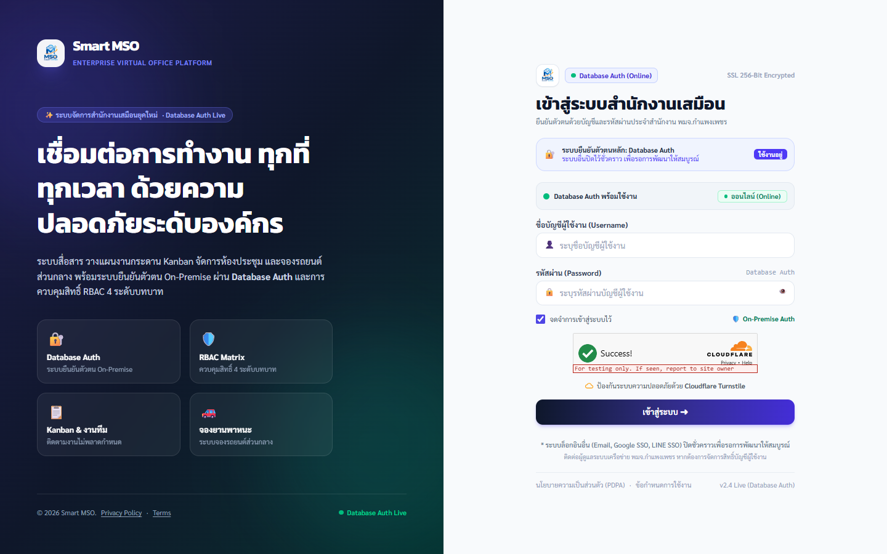
*ภาพที่ 1: หน้าจอกรอก Username / Password พร้อมสถานะ Database Auth (Online) และเกราะป้องกัน Cloudflare Turnstile*

| จุดมาร์กบนภาพ | ขั้นตอน / ตำแหน่งบนหน้าจอ (UI Callout) | รายละเอียดการใช้งาน |
| :---: | :--- | :--- |
| **①** | **ตรวจสอบสถานะ `Database Auth (Online)` & SSL** | สังเกตป้าย `Database Auth (Online)` และ `SSL 256-Bit Encrypted` ด้านบนขวา รวมถึงแบนเนอร์แนะนำกลไกยืนยันตัวตนหลักของสำนักงาน |
| **②** | **เช็กสัญญาณพร้อมใช้งานฐานข้อมูล** | แถบสีเขียว `Database Auth พร้อมใช้งาน • ออนไลน์` ยืนยันว่าระบบพร้อมตรวจสอบสิทธิ์กับฐานข้อมูลสำนักงานแล้ว |
| **③** | **กรอก Username / Password & สลับดูรหัสผ่าน (`👁️`)** | พิมพ์ชื่อบัญชีผู้ใช้งานและรหัสผ่าน กดไอคอนรูปตา `👁️` เพื่อตรวจความถูกต้องของอักขระ และติ๊ก **`จดจำการเข้าสู่ระบบไว้`** เมื่อใช้งานบนเครื่องส่วนตัว (หลีกเลี่ยงบนเครื่องส่วนกลาง) |
| **④** | **เกราะป้องกันบอท Cloudflare Turnstile** | รอให้กรอบ **Cloudflare Turnstile** แสดงเครื่องหมาย **`Success!`** อัตโนมัติ ระบบป้องกันสแปมและการสุ่มรหัสผ่านจากภายนอก |
| **⑤** | **กดปุ่ม `เข้าสู่ระบบ ➔`** | คลิกปุ่ม **`เข้าสู่ระบบ ➔`** ระบบตรวจสอบสิทธิ์ตามบทบาท (`RBAC`) และพาเข้าสู่หน้าแรก Dashboard ทันที (กรณีอยู่ภายในวง LAN สำนักงาน หาก Cloudflare Tunnel ขัดข้อง ระบบรองรับ Fallback ผ่าน Synology DSM อัตโนมัติ) |

### 1.2–1.3 โครงสร้างเมนู 5 กลุ่มหลัก และหน้าแรกภาพรวมสำนักงาน (Dashboard)

เส้นทาง: `📊 ภาพรวม` ➔ `📊 หน้าแรก` (`/dashboard`)

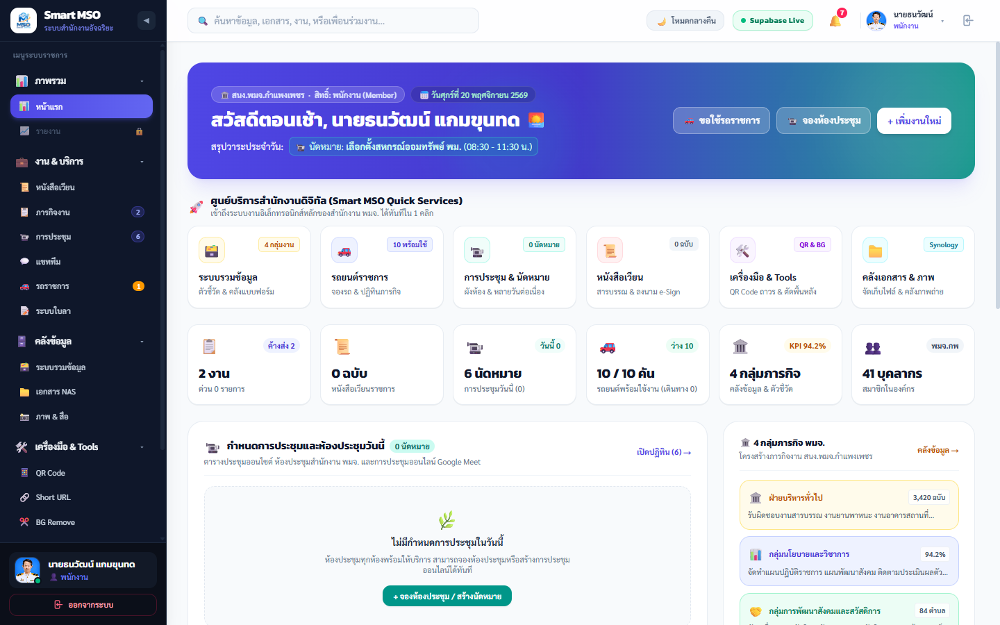
*ภาพที่ 2: หน้าแรก Dashboard (เมนู 5 กลุ่มซ้าย, Top Bar, Quick Actions, ศูนย์บริการดิจิทัล 6 การ์ด, บัตร KPI 6 ใบ และ 4 กลุ่มภารกิจ)*

| จุดมาร์กบนภาพ | ตำแหน่งบนหน้าจอ | องค์ประกอบและคำอธิบาย |
| :---: | :--- | :--- |
| **①** | **แถบเมนูนำทาง 5 กลุ่ม (ซ้าย)** | รวมเมนูหลัก `ภาพรวม`, `งาน & บริการ`, `คลังข้อมูล`, `เครื่องมือ & Tools`, และ `การจัดการ` พร้อมปุ่มย่อ/ขยายเมนู `◀` และสัญลักษณ์ `🔒` หน้าเมนูที่จำกัดสิทธิ์ตามบทบาท |
| **②** | **Top Bar เครื่องมือส่วนบน** | ช่องค้นหารวมข้ามโมดูล, ปุ่ม **🌙 โหมดกลางคืน** (สลับธีม Light/Dark), ป้ายสถานะ **🟢 Supabase Live**, กระดิ่ง **🔔 แจ้งเตือน**, และปุ่ม **ออกจากระบบ** |
| **③** | **Quick Actions (ปุ่มทางลัดด่วน)** | เข้าถึงงานประจำวันได้ใน 1 คลิกจากแบนเนอร์ต้อนรับ: `🚗 ขอใช้รถราชการ`, `📹 จองห้องประชุม`, และ `+ เพิ่มงานใหม่` |
| **④** | **ศูนย์บริการดิจิทัล 6 การ์ด & บัตร KPI สด 6 ใบ** | แสดงสถานะ Realtime ของงานค้าง (`2 งาน`), หนังสือเวียน (`0 ฉบับ`), นัดหมาย (`6 นัดหมาย`), รถว่าง (`10 / 10 คัน`), KPI และจำนวนสมาชิก (41 ท่าน) |
| **⑤** | **กำหนดการวันนี้ & 4 กลุ่มภารกิจ พมจ.** | สรุปนัดหมายประชุมประจำวัน และความคืบหน้าของ 4 กลุ่มงานหลัก พมจ.กำแพงเพชร พร้อมปุ่มเปิดดูรายละเอียด |

### 1.4 ศูนย์การแจ้งเตือนแบบแยกหมวดหมู่ (Notifications Center)

เส้นทาง: แถบ Header ด้านบนขวา ➔ คลิกไอคอนกระดิ่ง `🔔`


*ภาพที่ 3: ศูนย์การแจ้งเตือน (Notifications Center) แยก 5 หมวดหมู่ พร้อมปุ่มจัดการสถานะอ่านและลิงก์เปิดดูรายการ*

1. **① เปิดหน้าต่างแจ้งเตือน (`🔔`):** ตัวเลขสีแดงบนกระดิ่งแสดงจำนวนรายการใหม่ที่ยังไม่อ่าน คลิกเพื่อเปิด Dropdown แบบเรียลไทม์
2. **② จัดการสถานะอ่านทั้งหมด & แจ้งเตือนเบราว์เซอร์:** คลิก **`✓ อ่านทั้งหมด`** เพื่อล้างยอดค้างอ่าน หรือกด **`เปิดใช้งาน`** เพื่อเปิดรับ Web Notification บนเดสก์ท็อป/มือถือ
3. **③ ตัวกรอง 5 หมวดหมู่:** กดสลับดูเฉพาะ **`ทั้งหมด`**, **`แชททีม`**, **`เวียนหนังสือ`**, **`ประชุม`**, **`งาน Kanban`**, หรือ **`รถราชการ`**
4. **④ เปิดดูรายการทันที:** คลิกปุ่ม **`เปิดดู ➔`** บนการ์ดแจ้งเตือนแต่ละรายการเพื่อข้ามไปยังโมดูลเป้าหมายได้ทันที

### 1.5 วิเคราะห์จุดเด่น ระบบเดิม vs Smart MSO, ฟังก์ชันพิเศษ & คำแนะนำพิเศษ (บทที่ 1)

| ประเด็นเปรียบเทียบ | ระบบเดิม (กระดาษ / แยกไฟล์) | ระบบ Smart MSO (ดิจิทัล) | ประโยชน์หลักที่สำนักงานได้รับ |
| :--- | :--- | :--- | :--- |
| **การเข้าถึงระบบงาน** | ต้องเปิดหลายโปรแกรม/หลายลิงก์ แยกแฟ้มหรือจำรหัสหลายชุด ไม่มีจุดรวมศูนย์ | Single Portal ที่ `smso.site` ล็อกอินครั้งเดียวผ่านบัญชีสำนักงาน เข้าได้ครบ 17 โมดูล | ลดเวลาเริ่มต้นทำงานประจำวัน และลดการลืมรหัสผ่านข้ามระบบ |
| **ติดตามงาน & นัดหมาย** | ต้องคอยถามปากเปล่า เช็กบอร์ดติดประกาศ หรือไล่อ่านในกลุ่มแชทยาวๆ | หน้าแรก Dashboard KPI รวมยอดงานค้าง นัดวันนี้ รถว่าง `10/10` คัน และกระดิ่งแจ้งเตือน Realtime | ผู้บริหารและเจ้าหน้าที่เห็นภาพรวมสำนักงานภายใน 3 วินาที |
| **ความปลอดภัยเข้าสู่ระบบ** | แชร์ไฟล์ในวงแลนหรือส่งลิงก์เปิด ไม่มีระบบป้องกันบอทและบันทึกสิทธิ์ระดับบทบาท | ตรวจสอบ `Database Auth` + เกราะป้องกัน `Cloudflare Turnstile` + สิทธิ์ `RBAC` | ป้องกันผู้ไม่หวังดีจากภายนอกและจำกัดการเห็นข้อมูลตามระดับหน้าที่ |

- **✨ ฟังก์ชันพิเศษเฉพาะสำนักงาน:** `Database Auth + Synology LAN Fallback อัตโนมัติ`, `ศูนย์แจ้งเตือน 5 หมวดเชื่อมทุกโมดูล`, และ `Quick Actions + Live KPI Cards`
- **💡 คำแนะนำพิเศษ (Pro Tips):** กดปุ่มย่อเมนู `◀` เพื่อขยายพื้นที่ตาราง Data Hub / Kanban บนหน้าจอโน้ตบุ๊ก; เปิด Browser Notifications ในหน้าข้อมูลส่วนตัว (`/user`) เพื่อรับแจ้งเตือนแม้ย่อหน้าต่างเบราว์เซอร์; สังเกตป้าย **🟢 Supabase Live** ด้านบนเพื่อยืนยันการซิงก์ฐานข้อมูลสด

---

## บทที่ 2: งานและบริการ — การประสานงาน & สื่อสารองค์กร

### 2.1 ระบบหนังสือเวียนอิเล็กทรอนิกส์ & การส่งหนังสือเวียน 3 ช่องทาง

เส้นทาง: `💼 งาน & บริการ` ➔ `📜 หนังสือเวียน` (`/circular`)

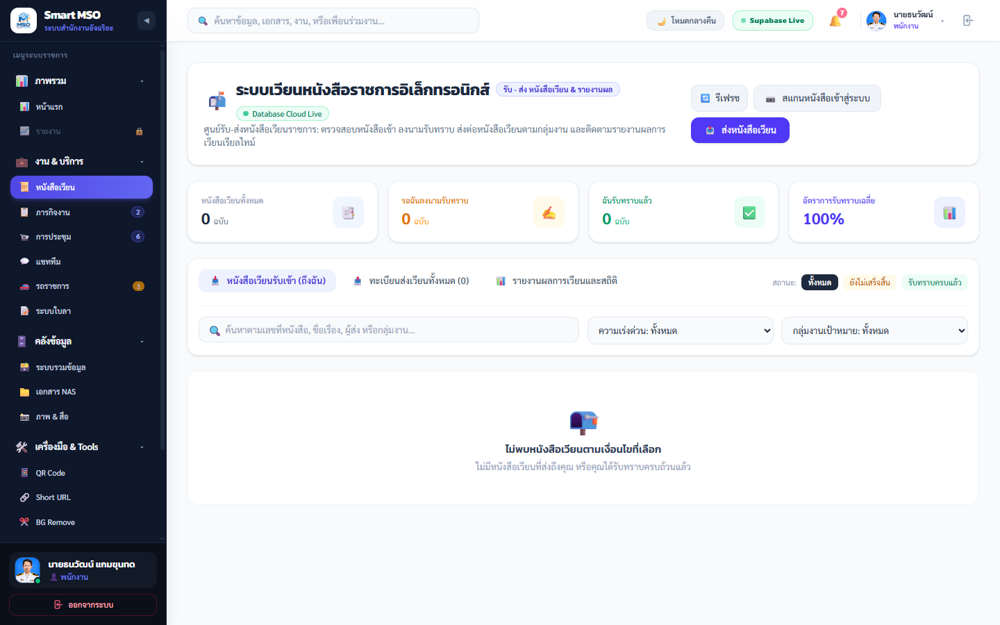
*ภาพที่ 4: หน้าหลักระบบเวียนหนังสือราชการอิเล็กทรอนิกส์ (`/circular`)*

1. **① ดู KPI 4 สถานะและเปิดส่งหนังสือเวียน:** ติดตามยอดหนังสือรอดำเนินการ ด่วนมาก/ด่วนที่สุด ลงนามรับทราบแล้ว และคลิกปุ่ม **`ส่งหนังสือเวียน`** (เปิดภาพที่ 5)
2. **② ค้นหาและกรองระดับความเร่งด่วน:** ค้นหาจากเลขที่หนังสือ/ชื่อเรื่อง และกรองตาม **`ปกติ`**, **`⚡ ด่วน`**, **`⚡⚡ ด่วนมาก`**, **`🚨 ด่วนที่สุด`**
3. **③ แท็บสลับมุมมอง & ประเภทหนังสือ:** สลับระหว่าง **`📥 หนังสือเวียนถึงฉัน`** และ **`📤 หนังสือเวียนที่ส่งออก`** พร้อมตัวกรองหนังสือภายนอก/ภายใน
4. **④ อ่านเอกสาร & กดลงนามรับทราบ:** เปิดดูไฟล์แนบและกดปุ่มลงนามรับทราบเพื่อบันทึก Timestamp เข้าระบบทันที

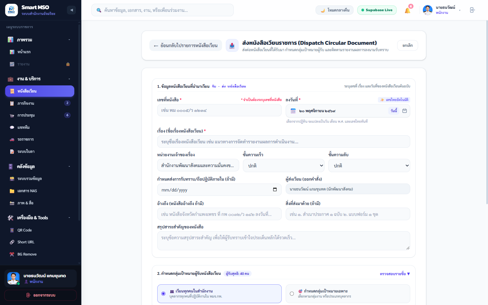
*ภาพที่ 5: หน้าต่างส่งหนังสือเวียนราชการ — แปลงวันที่เป็นเลขไทยอัตโนมัติ และแนบไฟล์ 3 ช่องทาง*

1. **① ส่วนหัวการออกหนังสือเวียน:** ตรวจสอบคำสั่งส่งหนังสือเวียนราชการ ใช้ปุ่ม **`← ย้อนกลับ`** หรือ **`ยกเลิก`** หากต้องการออกจากการร่าง
2. **② กรอกเลขที่หนังสือ ลงวันที่ & ✨ เลขไทยอัตโนมัติ:** ระบุเลขที่หนังสือและเลือกวันที่จากปฏิทิน ระบบแปลงเป็นเลขไทยให้ตรงตามระเบียบงานสารบรรณอัตโนมัติ (เช่น `๒๐ พฤศจิกายน ๒๕๖๙`)
3. **③ กำหนดชั้นความเร็ว ชั้นความลับ & สรุปสาระสำคัญ:** เลือกชั้นความเร็ว ชั้นความลับ หนังสืออ้างถึง สิ่งที่ส่งมาด้วย และสรุปประเด็นสำคัญ
4. **④ กำหนดกลุ่มเป้าหมาย & แนบไฟล์ 3 ช่องทาง:** เลือกเวียนทั้งสำนักงาน (40 ท่าน) หรือเฉพาะกลุ่มงาน พร้อมแนบไฟล์ได้ 3 ช่องทาง (สแกนสด, อัปโหลดจากเครื่อง, หรือดึงตรงจากคลัง `Synology NAS`)

### 2.2 กระดานติดตามภารกิจงาน (Kanban Board) & หน้าต่างเพิ่มงานกำหนด Scope

เส้นทาง: `💼 งาน & บริการ` ➔ `📋 ภารกิจงาน` (`/tasks`)

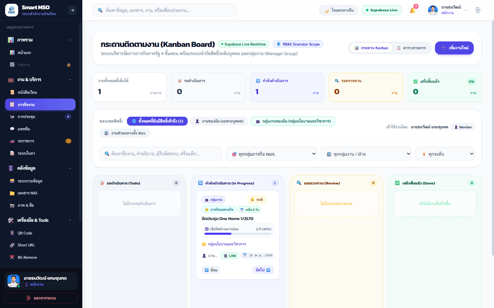
*ภาพที่ 6: กระดานติดตามงาน Kanban Board 4 สถานะ (`/tasks`)*

1. **① ตัวกรอง 8 กลุ่มภารกิจ & สถานะค้าง:** กรองงานตาม 8 กลุ่มภารกิจหลัก และกดปุ่ม **`+ เพิ่มงานใหม่`** (เปิดภาพที่ 7)
2. **② การ์ดงาน 4 สถานะ:** ติดตามการ์ดในคอลัมน์ **`📝 รอดำเนินการ (To Do)`**, **`⚡ กำลังดำเนินการ (In Progress)`**, **`👀 รอตรวจสอบ / แก้ไข (Review)`**, และ **`✅ เสร็จสิ้น (Done)`**
3. **③ ป้าย Visibility Scope & ผู้รับผิดชอบ:** แสดงขอบเขตการมองเห็น (`👥 กลุ่มงาน` / `🔒 เฉพาะบุคคล` / `🏢 ทั้งสำนักงาน`) ป้ายความเร่งด่วน และกำหนดส่ง
4. **④ อัปเดตสถานะและ Subtasks:** เปิดการ์ดงานเพื่อติ๊กรายการย่อยหรือย้ายคอลัมน์สถานะ

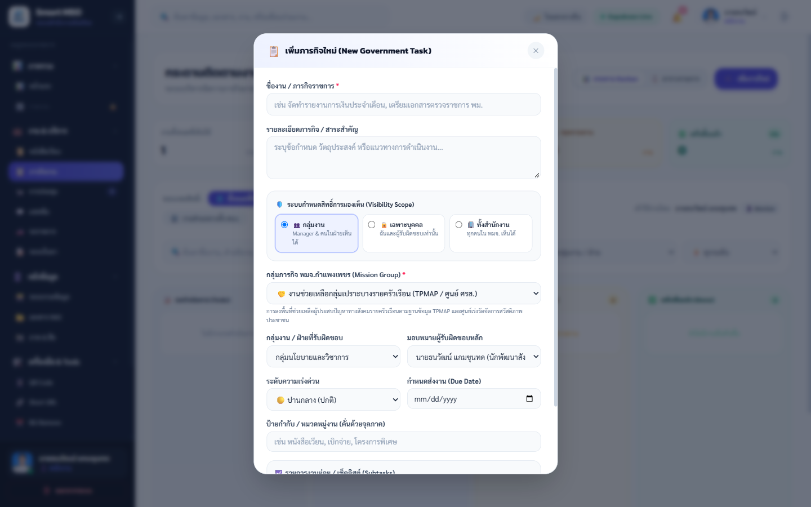
*ภาพที่ 7: หน้าต่างเพิ่มภารกิจใหม่ พร้อม `Visibility Scope` 3 ระดับและ 8 กลุ่มภารกิจ พมจ.กำแพงเพชร*

1. **① ชื่องานและสาระสำคัญ:** กรอกชื่อภารกิจและแนวทางดำเนินงาน
2. **② เลือกสิทธิ์การมองเห็น (`Visibility Scope`) 3 ระดับ:** กำหนดให้เห็นเฉพาะ **`👥 กลุ่มงาน`** (Manager & คนในฝ่าย), **`🔒 เฉพาะบุคคล`** (ฉันและผู้รับผิดชอบ), หรือ **`🏢 ทั้งสำนักงาน`**
3. **③ จัดหมวดหมู่ตามกลุ่มภารกิจ พมจ. (`Mission Group`):** เชื่อมกับ 8 หมวดภารกิจ (เช่น งานช่วยเหลือกลุ่มเปราะบาง TPMAP/ศรส., เงินอุดหนุนเด็กแรกเกิด, ศูนย์บริการคนพิการ)
4. **④ มอบหมายผู้รับผิดชอบ กำหนดความเร่งด่วน & Subtasks:** ระบุผู้รับผิดชอบ ระดับเร่งด่วน วันครบกำหนด (`Due Date`) ป้ายกำกับ และเช็กลิสต์ย่อย

### 2.3 ระบบการประชุม นัดหมาย & ผังจองห้องประชุม 5 ห้อง

เส้นทาง: `💼 งาน & บริการ` ➔ `📹 การประชุม` (`/meetings`)

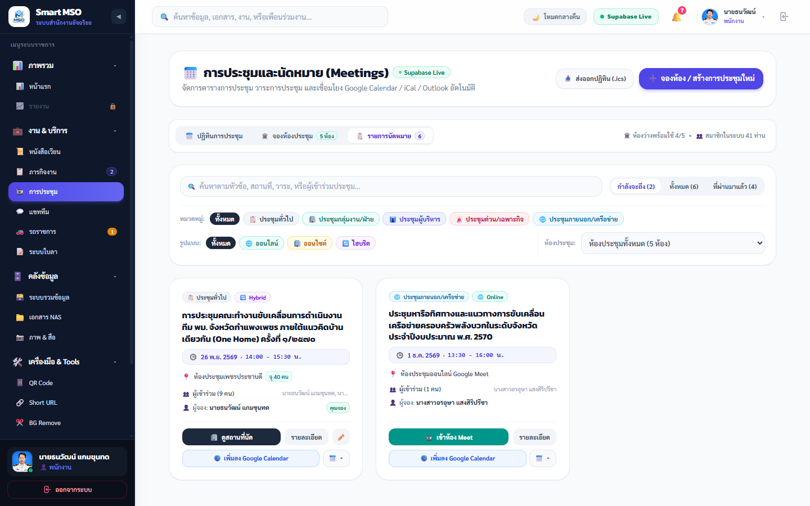
*ภาพที่ 8: หน้าหลักระบบการประชุม (`/meetings`)*

1. **① สถิติการประชุม & สร้างนัดหมายใหม่:** ดูจำนวนนัดหมายที่กำลังจะมาถึง ประชุมออนไลน์/ออนไซต์ และกด **`+ สร้างนัดหมายใหม่`**
2. **② กรองตามประเภทกิจกรรม 5 หมวดหมู่:** กรอง `ประชุมกลุ่ม`, `ลงพื้นที่/เยี่ยมบ้าน`, `ประชุม กบจ.`, `วิดีโอคอนเฟอเรนซ์`, หรือ `นัดหมายทั่วไป`
3. **③ ปุ่มเข้าห้อง Google Meet & Export `.ics`:** กดเข้าลิงก์ประชุมออนไลน์ หรือ **`📅 เพิ่มลง Google Calendar (.ics)`** บนการ์ดประชุมทันที
4. **④ สลับแท็บมุมมองปฏิทิน & จองห้องประชุม:** สลับดูแบบ **`ปฏิทินรายเดือน`** หรือกดแท็บ **`🏛️ จองห้องประชุม 5 ห้อง`** (ภาพที่ 9)

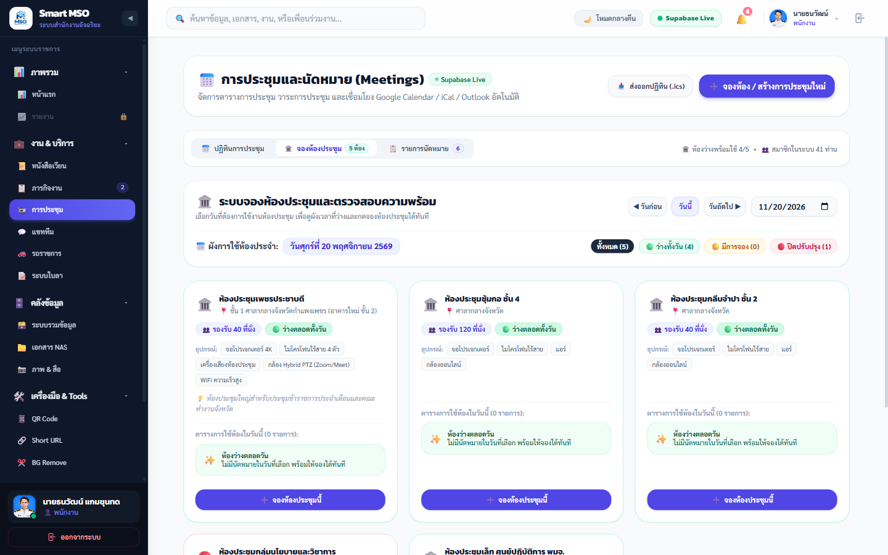
*ภาพที่ 9: แท็บระบบจองห้องประชุม 5 ห้อง แสดงสถานะว่าง/ไม่ว่าง อุปกรณ์โสตฯ และตารางเวลา*

1. **① สลับแท็บห้องประชุม & เลือกวันที่ใช้งาน:** เปิดแท็บ **`🏛️ จองห้องประชุม 5 ห้อง`** และเลือกวันที่ที่ต้องการใช้งาน
2. **② ตัวกรองสถานะความพร้อม (`ว่างพร้อมใช้งาน`):** กรองดูเฉพาะห้องที่ว่างในวัน/เวลาดังกล่าว ลดการโทรถามฝ่ายธุรการ
3. **③ การ์ดรายละเอียดห้องประชุม 5 ห้อง:** ตรวจสอบความจุคน อุปกรณ์ที่มี (เช่น จอ LED, ไมโครโฟน, ระบบ Zoom/Meet) และการจัดการเบรก
4. **④ ตรวจสอบ Timeline & กดจองห้องประชุม:** ตรวจดูช่วงเวลาที่มีการจองล่วงหน้าแล้วคลิกปุ่มจองห้อง

### 2.4 ระบบแชทกลุ่มราชการ & จัดเก็บไฟล์แนบลง Synology NAS

เส้นทาง: `💼 งาน & บริการ` ➔ `💬 แชททีม` (`/chat`)

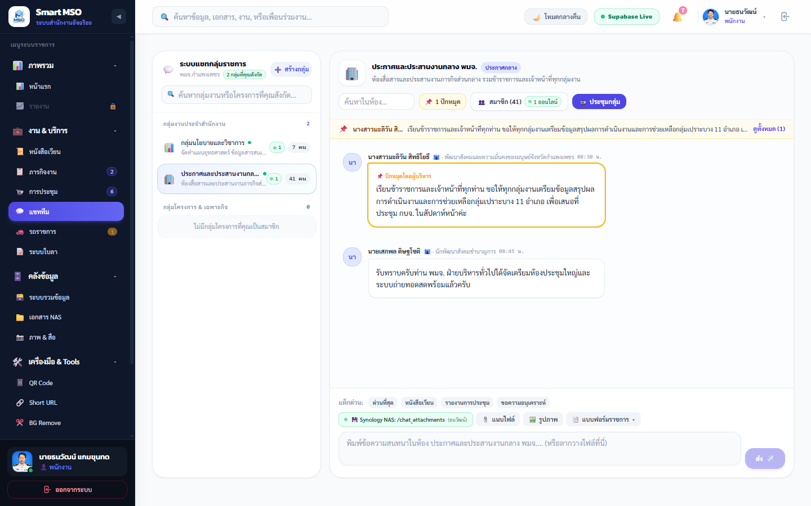
*ภาพที่ 10: ระบบแชทกลุ่มราชการแบบ Real-time (`/chat`)*

1. **① รายชื่อห้องสนทนาองค์กร 8 ห้อง:** เลือกห้องสนทนากลาง ห้องกลุ่มภารกิจ หรือสร้างห้องเฉพาะกิจสำหรับโครงการ
2. **② แถบค้นหา ปักหมุด & สถิติสมาชิก:** ค้นหาข้อความย้อนหลัง ดูรายการปักหมุด (`Pinned Messages`) และรายชื่อสมาชิกในห้อง
3. **③ กระดานสนทนาแบบ Real-time & แท็กความเร่งด่วน:** พูดคุยแบบเรียลไทม์พร้อมติดแท็กสีแบ่งหมวด เช่น **`ด่วนที่สุด`**, **`หนังสือเวียน`**, **`นัดประชุม`** และกด Reply อ้างอิงข้อความ
4. **④ แนบไฟล์และภาพขึ้น Synology NAS อัตโนมัติ:** แนบเอกสารหรือภาพหน้างานลงพื้นที่ ระบบจัดเก็บในโฟลเดอร์ `/chat_attachments` บน `Synology NAS` ไฟล์ไม่หมดอายุ

### 2.5 ระบบจองรถยนต์ราชการ 4 ขั้นตอนอนุมัติ & แบบ พมจ.กพ 02

เส้นทาง: `💼 งาน & บริการ` ➔ `🚗 รถราชการ` (`/carbooking`)

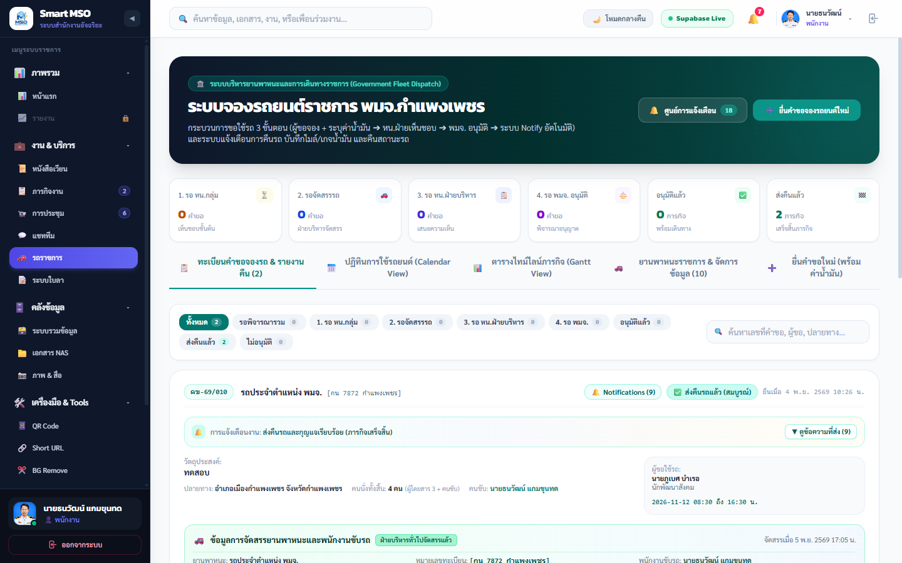
*ภาพที่ 11: หน้าหลักระบบจองรถยนต์ราชการ (`/carbooking`) ติดตามสถานะ 4 ขั้นตอนอนุมัติ*

1. **① สลับมุมมอง List / Calendar / Gantt View:** กดดูคิวใช้รถราชการทั้ง 10 คันแบบตาราง ปฏิทินรายเดือน หรือ **Gantt Timeline** เพื่อตรวจช่วงเวลาว่าง
2. **② การ์ดติดตามสายอนุมัติ 4 ขั้นตอน:** ติดตามความคืบหน้าตั้งแต่ `1. รอ หัวหน้ากลุ่ม` ➔ `2. รอ จัดสรรรถ` ➔ `3. รอ หัวหน้าฝ่ายบริหาร` ➔ `4. รอ พมจ. อนุมัติ` จนถึง `กำลังเดินทาง / คืนรถแล้ว`
3. **③ ทะเบียนคำขอ & สรุปประมาณการค่าน้ำมัน:** ตรวจสอบประวัติคำขอใช้รถ จุดหมายปลายทาง ระยะทาง และค่าน้ำมันประมาณการ
4. **④ บันทึกคืนรถ เลขไมล์ & เปิดแบบ พมจ.กพ 02:** กดปุ่มคืนรถเพื่อกรอกเลขไมล์เมื่อกลับถึงสำนักงาน หรือกดแท็บ **`➕ ยื่นคำขอใหม่ (พร้อมค่าน้ำมัน)`** (ภาพที่ 12)

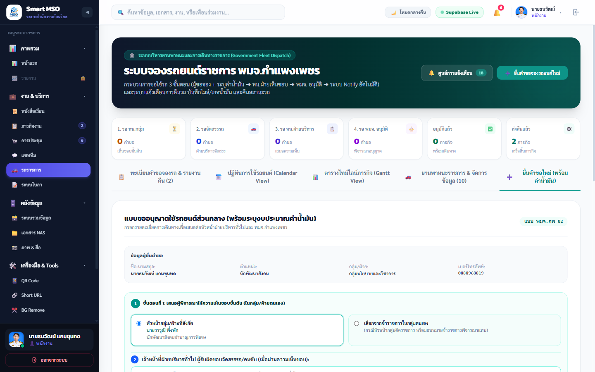
*ภาพที่ 12: แบบฟอร์ม `แบบ พมจ.กพ 02` ยื่นคำขอใช้รถราชการและขอเบิกค่าน้ำมัน*

1. **① แท็บ `+ ยื่นคำขอใหม่ (แบบ พมจ.กพ 02)`:** คลิกแท็บเพื่อเปิดแบบขออนุญาตใช้รถยนต์ส่วนกลางแบบดิจิทัล
2. **② ตรวจสอบข้อมูลผู้ยื่นคำขออัตโนมัติ:** ระบบดึงชื่อ–สกุล ตำแหน่ง กลุ่ม/ฝ่าย และข้อมูลติดต่อจากฐานข้อมูลให้อัตโนมัติ ลดการกรอกซ้ำ
3. **③ ขั้นตอนที่ 1 เลือกผู้เห็นชอบชั้นต้นในกลุ่ม/ฝ่าย:** ค่าเริ่มต้นระบุ **หัวหน้ากลุ่ม/ฝ่ายที่สังกัด** ให้อัตโนมัติ หรือเลือกสลับเป็นข้าราชการในกลุ่มพิจารณาแทนกรณีหัวหน้ากลุ่มติดราชการ
4. **④ ขั้นตอนที่ 2 จัดสรรรถ/คนขับ (10 คัน) & ปลายทางด่วน 11 อำเภอ:** ผู้ขอ *ไม่ต้องเลือกรถเอง* ฝ่ายบริหารทั่วไปจะจัดสรรรถราชการ 10 คันและคนขับในขั้นที่ 2 จากนั้นเลื่อนลงด้านล่างเพื่อกดปุ่ม **`🎯 ปลายทางด่วน`** ทั้ง **11 อำเภอ** (กรอกระยะทางไป-กลับ 35–175 กม. และคำนวณงบค่าน้ำมันให้อัตโนมัติ)

### 2.6 ระบบใบลาอิเล็กทรอนิกส์ (2 แบบฟอร์ม + แท็บใบลาของฉัน)

เส้นทาง: `💼 งาน & บริการ` ➔ `📝 ระบบใบลา` (`/leave`)

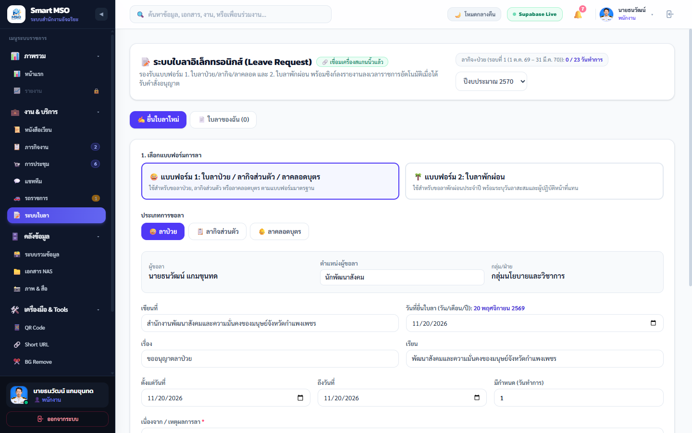
*ภาพที่ 13: ระบบใบลาอิเล็กทรอนิกส์ — แบบฟอร์ม 1 (ลาป่วย / ลากิจส่วนตัว / ลาคลอดบุตร)*

1. **① สถานะเชื่อมเครื่องสแกนนิ้ว & โควตาลากิจ+ป่วย:** สังเกตป้าย `🔗 เชื่อมเครื่องสแกนนิ้วแล้ว`, กรอบวันลารวม (`0 / 23 วันทำการ` รอบ 6 เดือน) และตัวเลือกปีงบประมาณไทย (`2569–2571`)
2. **② สลับแท็บประเภทฟอร์ม & รายการใบลา:** เลือกแท็บ `แบบฟอร์ม 1 (ป่วย/กิจ/คลอด)`, `แบบฟอร์ม 2 (พักผ่อน)`, หรือ `รายการใบลาของฉัน`
3. **③ เลือกประเภทการลา & ระบุช่วงวันลา:** ระบบคำนวณวันทำการให้อัตโนมัติโดยเว้นวันหยุดราชการและเสาร์-อาทิตย์
4. **④ เหตุผลการลา ติดต่อระหว่างลา & สายอนุมัติ 3 ขั้น:** ระบุเหตุผล ผู้รับมอบงานแทน และตรวจสอบสายอนุมัติ 3 ขั้น (`หัวหน้ากลุ่ม` ➔ `ฝ่ายบริหาร` ➔ `พมจ.`) ก่อนกดยื่นคำขอ

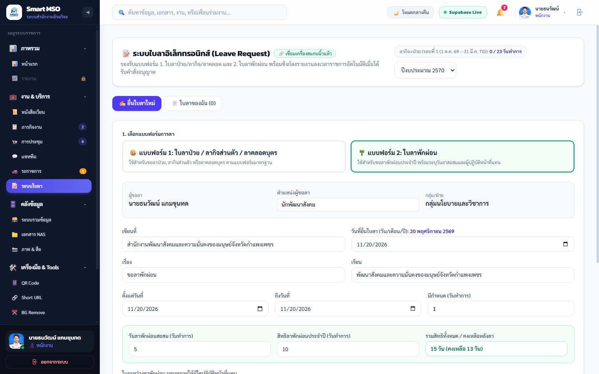
*ภาพที่ 14: ระบบใบลาอิเล็กทรอนิกส์ — แบบฟอร์ม 2 (ใบลาพักผ่อนประจำปี)*

1. **① เลือกแบบฟอร์ม 2 (ลาพักผ่อนประจำปี):** คำนวณสิทธิ์ลาพักผ่อนประจำปีแยกต่างหากจากแบบฟอร์ม 1
2. **② ตรวจสอบยอดวันลาพักผ่อนสะสม:** แสดงจำนวนวันลาพักผ่อนสะสมจากปีก่อน สิทธิ์ปีปัจจุบัน และยอดวันลาคงเหลือ
3. **③ กำหนดช่วงวันที่ต้องการพักผ่อน & ผู้ปฏิบัติงานแทน:** ระบบนับวันทำการสุทธิให้อัตโนมัติ พร้อมตรวจสอบวันลาทับซ้อน
4. **④ สายอนุมัติและปุ่มส่งใบลา:** ส่งเข้าคิวพิจารณาตามลำดับชั้น และเมื่ออนุมัติครบขั้นตอน ระบบจะซิงก์เข้าหมายเหตุรายงานลงเวลาราชการ (`/attendance`) อัตโนมัติ

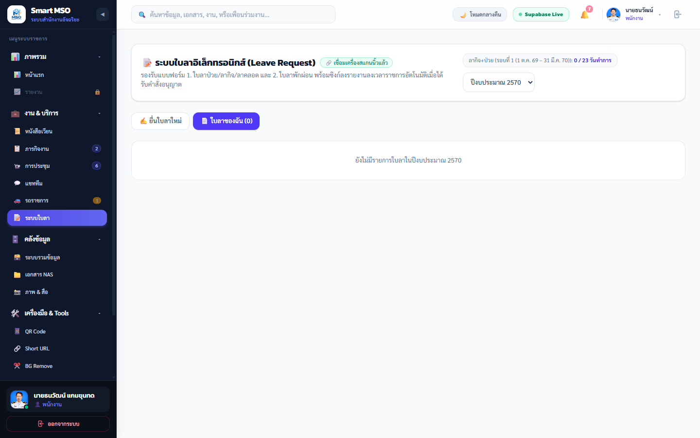
*ภาพที่ 15: แท็บรายการใบลาของฉัน และตัวกรองปีงบประมาณไทย (1 ต.ค. – 30 ก.ย.)*

1. **① แท็บ `ใบลาของฉัน` & ตัวกรองปีงบประมาณ:** ตรวจสอบใบลาทุกฉบับย้อนหลังแยกตามปีงบประมาณไทย
2. **② สถานะสายอนุมัติแบบ Step-by-Step:** มองเห็นชัดเจนว่าเอกสารอยู่ระหว่างการพิจารณาของผู้ใด
3. **③ ประวัติวันลา & ยอดคงเหลือ:** ใช้อ้างอิงร่วมกับการสรุปผลปฏิบัติงานรอบ 6 เดือน (รอบ 1 ต.ค. และ รอบ 1 เม.ย.)

### 2.7 วิเคราะห์จุดเด่น ระบบกระดาษเดิม vs Smart MSO, ฟังก์ชันพิเศษ & คำแนะนำพิเศษ (บทที่ 2)

| ประเด็นเปรียบเทียบ | ระบบเดิม (กระดาษ / งานมือ) | ระบบ Smart MSO (ดิจิทัล) | ประโยชน์หลักที่สำนักงานได้รับ |
| :--- | :--- | :--- | :--- |
| **งานสารบรรณหนังสือเวียน** | เดินแฟ้มเวียนกระดาษทีละโต๊ะ ช้า เสี่ยงแฟ้มค้างหรือเอกสารสูญหาย ไม่รู้ใครอ่านแล้ว | เวียนอิเล็กทรอนิกส์ 1 คลิก แนบได้ 3 ช่องทาง รู้อัตราลงนามรับทราบแบบ Realtime | ลดกระดาษ 100% ลดเวลาเดินแฟ้มข้ามกลุ่มงานจากหลายวันเหลือหลักนาที |
| **การจองรถยนต์ส่วนกลาง** | เขียนใบขอ พมจ.กพ 02 ด้วยมือ เดินตามลายเซ็น 4 โต๊ะ ไม่รู้ตารางรถว่าง/ชนกันหรือไม่ | แบบ `พมจ.กพ 02` ดิจิทัล ปุ่มปลายทางด่วน 11 อำเภอ Gantt View & แจ้งเตือนครบ 4 ขั้น | ป้องกันจองรถซ้อน คาดการณ์งบน้ำมันแม่นยำ และเก็บประวัติคืนรถโปร่งใส |
| **การขออนุญาตลา** | เขียนใบลา นับวันลากิจ+ป่วยเอง ยื่นแฟ้มรอสถิติ-หน.ฝ่าย-พมจ. และคีย์วันลาลงรายงานเวลาซ้ำ | คำนวณวันลา+คงเหลืออัตโนมัติ ส่งผ่านสายอนุมัติ 3 ขั้น และซิงก์เข้า `/attendance` ทันที | ไม่ผิดพลาดเรื่องโควตา 23 วัน/ลาสะสม และลดงานซ้ำซ้อนของฝ่ายธุรการ |
| **ติดตามภารกิจ & ประชุม** | สั่งงานในแชทส่วนตัวข้อความเลื่อนหาย นัดประชุมต้องถามห้องว่างผ่านโทรศัพท์ | Kanban 4 สถานะพร้อม RBAC Scope + ผังห้อง 5 ห้อง/อุปกรณ์ + Google Calendar `.ics` | ติดตามความก้าวหน้า Subtasks ได้แม่นยำและไม่มีปัญหาจองห้องประชุมซ้ำซ้อน |

- **✨ ฟังก์ชันพิเศษเฉพาะสำนักงาน:** `ปุ่มปลายทางด่วน 11 อำเภอ + คำนวณค่าน้ำมันอัตโนมัติในแบบ พมจ.กพ 02`, `แปลงวันที่เป็นเลขไทยอัตโนมัติในหนังสือเวียน`, และ `ซิงก์ใบลาอนุมัติเข้าเครื่องสแกนนิ้ว + ไฟล์แชทบน Synology NAS`
- **💡 คำแนะนำพิเศษ (Pro Tips):** เปิด **Gantt View** ก่อนยื่นขอใช้รถช่วงภารกิจหนาแน่น; กดปุ่ม **📅 เพิ่มลง Google Calendar (`.ics`)** บนการ์ดประชุมเพื่อรับเตือนก่อนเวลา 15–30 นาที; ใช้ปุ่มปักหมุดและติดแท็ก **`🚨 ด่วนที่สุด / 📜 หนังสือเวียน`** ในแชทกลุ่มเพื่อค้นหาย้อนหลังได้ในเสี้ยววินาที

---

## บทที่ 3: คลังข้อมูล สารบรรณ & บริการองค์กร

### 3.1 ศูนย์ข้อมูลและสถิติสังคม (Data Hub 6 แท็บ) & TPMAP กำแพงเพชร 5 ปี

เส้นทาง: `🗄️ คลังข้อมูล` ➔ `🗃️ ระบบรวมข้อมูล` (`/data-hub`)

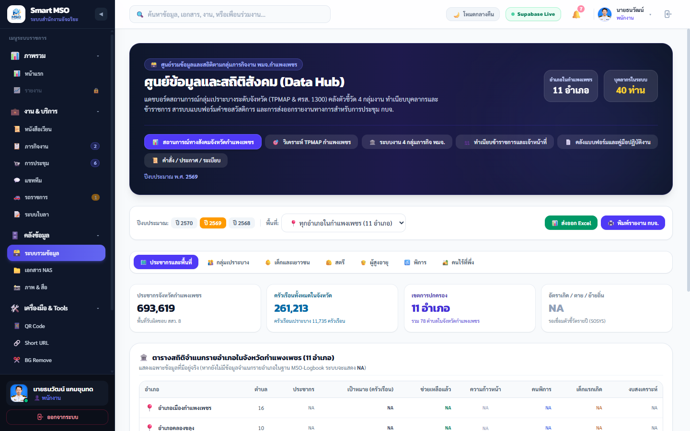
*ภาพที่ 16: Data Hub แท็บที่ 1 — สถานการณ์ทางสังคมจังหวัดกำแพงเพชร 11 อำเภอ 78 ตำบล*

1. **① แถบ 6 แท็บหลักของ Data Hub:** สลับดูข้อมูล `สถานการณ์ทางสังคมฯ`, `🎯 วิเคราะห์ TPMAP`, `🏛️ ระบบงาน 4 กลุ่มภารกิจ`, `👥 ทำเนียบบุคลากร`, `📋 คลังแบบฟอร์ม`, และ `📜 คลังคำสั่ง/ประกาศ`
2. **② บัตรตัวเลขสถิติกลุ่มเป้าหมายจังหวัด:** แสดงภาพรวมข้อมูลทางสังคมทั้งจังหวัดแบบแยกมิติและอัปเดตล่าสุด
3. **③ ตัวกรองรายอำเภอ 11 อำเภอ & 78 ตำบล:** เจาะลึกข้อมูลสถิติรายพื้นที่ระดับอำเภอและตำบลใน จ.กำแพงเพชร
4. **④ ส่งออกรายงาน กบจ. & Excel:** ดาวน์โหลดตารางสถิติเป็น `.xlsx` หรือสั่งพิมพ์รายงานสรุปสำหรับคณะกรรมการบริหารงานจังหวัด (กบจ.)

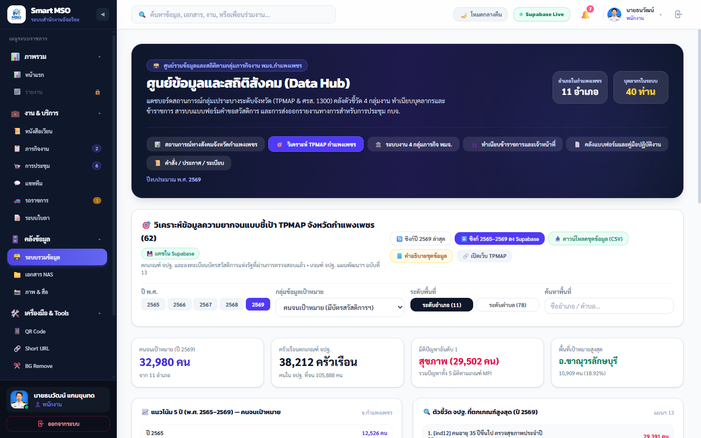
*ภาพที่ 17: Data Hub แท็บที่ 2 — วิเคราะห์ข้อมูล TPMAP จังหวัดกำแพงเพชร ปี 2565–2569 (ระดับ 11 อำเภอ)*

1. **① เลือกปีงบประมาณข้อมูล (`พ.ศ. 2565–2569`) & ซิงก์ข้อมูล:** กดเปลี่ยนปีที่ต้องการวิเคราะห์ (เชื่อมข้อมูลจริงจาก `tpmap.in.th` ที่ซิงก์ลงฐานข้อมูล Supabase ของสำนักงาน)
2. **② สลับระดับ `อำเภอ (11)` ↔ `ตำบล (78)`:** สลับดูตารางและแผนภูมิระหว่าง 11 อำเภอ กับ 78 ตำบลได้ทันที
3. **③ การ์ด KPI สรุปภาพรวมจังหวัด:** แสดงจำนวนคนจนเป้าหมาย ครัวเรือนตกเกณฑ์ จปฐ. มิติปัญหาอันดับ 1 และอำเภอเป้าหมายสูงสุด
4. **④ ตารางเปรียบเทียบ 11 อำเภอ & 5 มิติ MPI:** วิเคราะห์มิติ `สุขภาพ`, `ความเป็นอยู่`, `การศึกษา`, `เศรษฐกิจ`, และ `คุ้มครองทางสังคม`

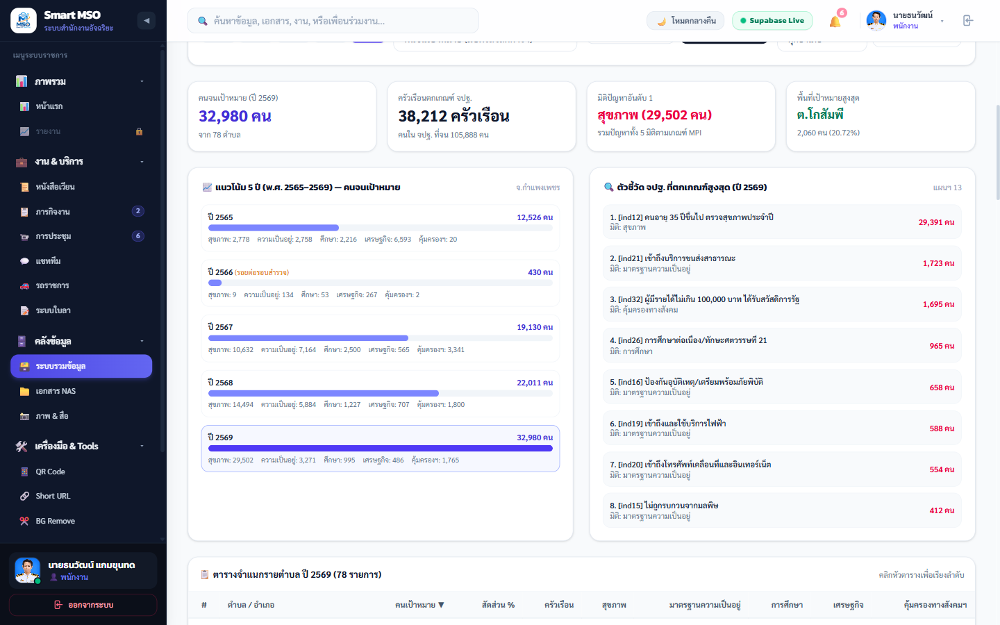
*ภาพที่ 18: TPMAP ระดับตำบล 78 ตำบล — กราฟแนวโน้ม 5 ปี, Top-8 ตัวชี้วัด จปฐ. และตารางเรียงตาม 5 มิติ*

1. **① สรุปผลเป้าหมายระดับตำบล 78 แห่ง:** แสดงยอดคนจนเป้าหมายระดับตำบล (เช่น `32,980 คน` ในระดับภาพรวมตำบล / ตำบลเป้าหมายสูงสุด `ต.โกสัมพี 2,060 คน · 20.72%`)
2. **② กราฟแท่งแนวโน้ม 5 ปี (`พ.ศ. 2565–2569`) คลิกสลับปีได้:** แสดงวิวัฒนาการคนจนเป้าหมายแต่ละปีพร้อมตัวเลข 5 มิติ MPI คลิกที่แท่งปีเพื่อสลับดูข้อมูลปีนั้นทันที
3. **③ จัดอันดับ 8 ตัวชี้วัด จปฐ. ตกเกณฑ์สูงสุด (`แผนฯ 13`):** ชี้เป้าปัญหาที่พบบ่อยที่สุด เช่น `[ind12] ตรวจสุขภาพอายุ 35+ ปี`, `[ind21] ขนส่งสาธารณะ`, `[ind32] สวัสดิการรัฐ`
4. **④ ตาราง 78 ตำบลเรียงลำดับตาม 5 มิติ MPI:** คลิกหัวคอลัมน์เพื่อจัดอันดับตำบลที่มีปัญหาเฉพาะด้านสำหรับการวางแผนลงพื้นที่ช่วยเหลือ


*ภาพที่ 19: Data Hub แท็บที่ 3 — โครงสร้างระบบงาน 4 กลุ่มภารกิจ พมจ.กำแพงเพชร*

1. **① เลือกแท็บ `🏛️ ระบบงาน 4 กลุ่มภารกิจ พมจ.`:** ดูขอบเขตความรับผิดชอบและตัวชี้วัดของแต่ละกลุ่มงาน
2. **② ค้นหาและคัดกรองกลุ่มงาน:** ค้นหากลุ่มภารกิจหรือหัวข้อภารกิจเฉพาะด้าน
3. **③ การ์ด 4 กลุ่มภารกิจหลัก:** แสดงข้อมูล `ฝ่ายบริหารทั่วไป`, `กลุ่มนโยบายและวิชาการ`, `กลุ่มการพัฒนาสังคมและสวัสดิการ`, และ `ศูนย์บริการคนพิการจังหวัด`

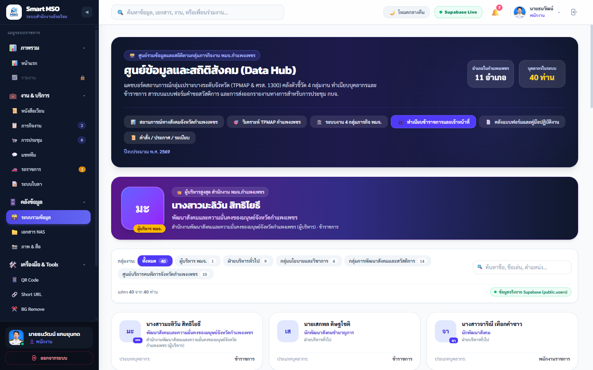
*ภาพที่ 20: Data Hub แท็บที่ 4 — ทำเนียบบุคลากร พมจ.กำแพงเพชร (40 ท่าน)*

1. **① เลือกแท็บ `👥 ทำเนียบบุคลากร`:** เปิดดูรายชื่อและตำแหน่งเจ้าหน้าที่ทั้งสำนักงาน
2. **② ค้นหาและกรองตามฝ่าย/ประเภทการจ้าง:** ค้นหาตามชื่อ ตำแหน่ง กลุ่มงาน หรือสถานะข้าราชการ/พนักงานราชการ/จ้างเหมา
3. **③ การ์ดรายชื่อบุคลากร:** แสดงข้อมูลบทบาท กลุ่มงานสังกัด และสถานะผู้ใช้งานระบบ (โดยสงวนข้อมูลส่วนบุคคลตามนโยบาย PDPA)

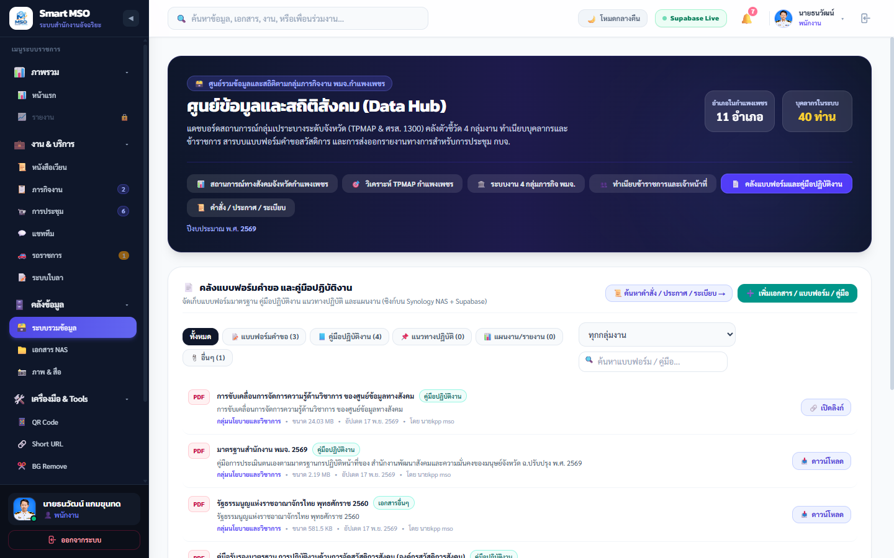
*ภาพที่ 21: Data Hub แท็บที่ 5 — คลังแบบฟอร์มและคู่มือปฏิบัติงาน*

1. **① เลือกแท็บ `📋 คลังแบบฟอร์มและคู่มือ`:** ศูนย์รวมไฟล์เอกสารมาตรฐานที่ใช้บ่อยในสำนักงาน
2. **② ค้นหาแบบฟอร์ม & ตัวกรองหมวดหมู่:** ค้นหาตามชื่อฟอร์ม เช่น คำขอสวัสดิการ ฟอร์มพัสดุ หรือแบบประเมินสังคมสงเคราะห์
3. **③ รายการเอกสาร & ปุ่มดาวน์โหลด:** กดดาวน์โหลดเอกสารต้นฉบับพร้อมใช้งาน (Word / PDF / Excel) ได้ทันที

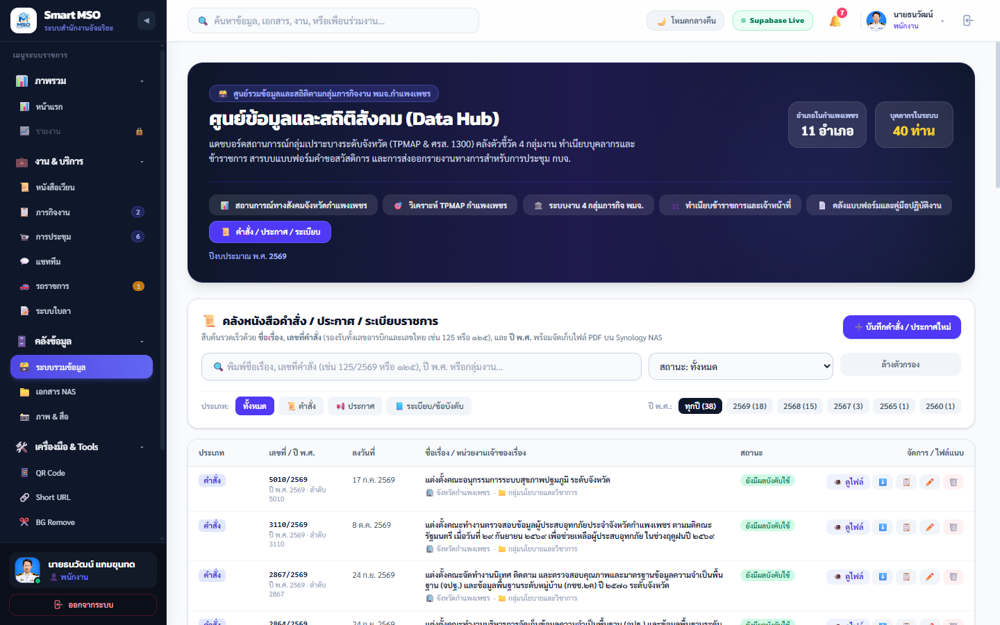
*ภาพที่ 22: Data Hub แท็บที่ 6 — คลังคำสั่ง / ประกาศ / ระเบียบราชการ*

1. **① เลือกแท็บ `📜 คลังคำสั่ง / ประกาศ`:** ตรวจสอบคำสั่งแต่งตั้ง คำสั่งมอบหมายงาน และประกาศสำนักงาน
2. **② ค้นหาและกรองตามปี พ.ศ. / ประเภทคำสั่ง:** หาเลขคำสั่งหรือคำสำคัญได้ในไม่กี่วินาที
3. **③ รายการคำสั่งราชการ & เปิดอ่านไฟล์ PDF:** กดเปิดดูคำสั่งฉบับจริงจากคลังจัดเก็บกลางของสำนักงาน

### 3.2 คลังเอกสารราชการ Synology File Station (หน้าหลัก + ท่องโฟลเดอร์/อัปโหลด)

เส้นทาง: `🗄️ คลังข้อมูล` ➔ `📁 เอกสาร NAS` (`/files`)

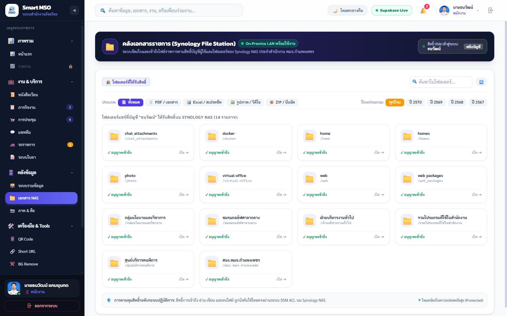
*ภาพที่ 23: คลังเอกสารราชการ Synology File Station (`/files`) แสดงสถานะ On-Premise LAN และการคุมสิทธิ์ DSM ACL*

1. **① ตรวจสอบสถานะ On-Premise & บัญชี DSM:** ดูแถบสถานะเชื่อมต่อ `Synology NAS` และชื่อบัญชีผู้ใช้งานที่เข้าสู่ระบบผ่าน DSM ACL
2. **② แถบนำทางหลัก & ปุ่มรีเฟรช:** ย้อนกลับระดับโฟลเดอร์หรือสั่งรีเฟรชรายการไฟล์ล่าสุดจาก NAS
3. **③ การ์ดโฟลเดอร์หลักที่ได้รับสิทธิ์ (`Shared Folders`):** แสดงเฉพาะโฟลเดอร์ที่มีสิทธิ์เข้าถึง (เช่น `/virtual-office`) เพื่อรักษาความปลอดภัยข้อมูลราชการ
4. **④ ปุ่ม `เปิด ➔` เข้าสู่โฟลเดอร์:** คลิกเปิดดูโครงสร้างโฟลเดอร์ย่อยภายใน (ภาพที่ 24)

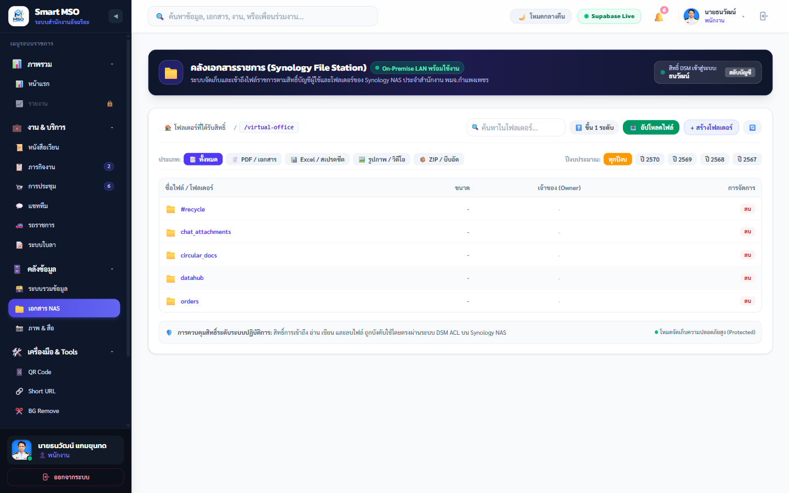
*ภาพที่ 24: การนำทางภายในโฟลเดอร์ `/virtual-office` บน Synology NAS*

1. **① แถบนำทาง Breadcrumb (`🏠 โฟลเดอร์ที่ได้รับสิทธิ์ / virtual-office`):** คลิกชื่อโฟลเดอร์ต้นทางหรือปุ่มบ้านเพื่อกระโดดกลับระดับก่อนหน้าได้ทันที
2. **② เครื่องมือจัดการไฟล์ (`⬆️ ขึ้น 1 ระดับ`, `📤 อัปโหลดไฟล์`, `+ สร้างโฟลเดอร์`):** ค้นหาไฟล์ภายใน อัปโหลดเอกสารจากเครื่องขึ้น NAS หรือสร้างโฟลเดอร์ใหม่ตามสิทธิ์ที่ได้รับ
3. **③ กรองตามนามสกุลไฟล์ & ปีงบประมาณ:** กดสลับกรองเฉพาะ `PDF`, `Excel`, `รูปภาพ/วิดีโอ`, `ZIP` หรือปี `2567–2570`
4. **④ ตารางรายชื่อไฟล์/โฟลเดอร์ (DSM Protected):** คลิกเปิดโฟลเดอร์ย่อย (เช่น `circular_docs`, `datahub`, `orders`, `chat_attachments`) ดาวน์โหลด หรือเปิดดูตัวอย่างไฟล์ภายใต้ระบบสิทธิ์ DSM ACL

### 3.3 คลังภาพและสื่อราชการ (Synology Photos)

เส้นทาง: `🗄️ คลังข้อมูล` ➔ `📸 ภาพ & สื่อ` (`/gallery`)

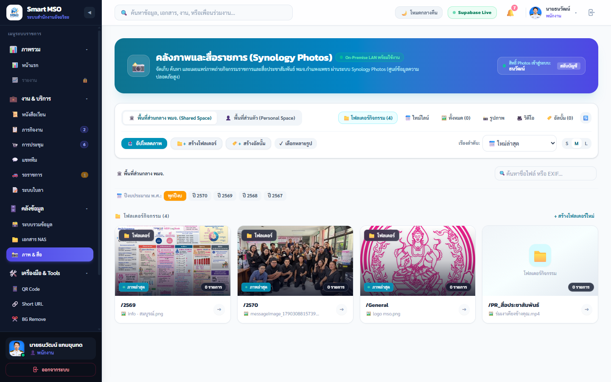
*ภาพที่ 25: คลังภาพและสื่อราชการ (`Synology Photos`) บน `/gallery`*

1. **① สลับพื้นที่ `Shared Space` (ภาพกลางสำนักงาน) ↔ `Personal Space`:** แยกคลังภาพกิจกรรมสำนักงานส่วนกลางออกจากอัลบั้มส่วนตัวของผู้ใช้
2. **② อัปโหลดภาพกิจกรรม & จัดหมวดหมู่อัลบั้ม:** ค้นหาอัลบั้มงานลงพื้นที่ อัปโหลดรูปความละเอียดสูงเก็บใน NAS โดยไม่ลดทอนคุณภาพเหมือนการส่งผ่านแอปแชททั่วไป
3. **③ ตารางอัลบั้มภาพ & ดูภาพขนาดเต็ม:** เปิดดู Lightbox ภาพกิจกรรมและดาวน์โหลดภาพต้นฉบับไปใช้จัดทำข่าวประชาสัมพันธ์หรือรายงานผลปฏิบัติงาน

### 3.4 วิเคราะห์จุดเด่น คลังเดิม vs Data Hub + NAS, ฟังก์ชันพิเศษ & คำแนะนำพิเศษ (บทที่ 3)

| ประเด็นเปรียบเทียบ | ระบบเดิม (แฟ้ม / แชร์ไดรฟ์ / ไฟล์กระจัดกระจาย) | ระบบ Smart MSO (Data Hub + Synology NAS) | ประโยชน์หลักที่สำนักงานได้รับ |
| :--- | :--- | :--- | :--- |
| **คลังข้อมูลสถิติสังคม & TPMAP** | ข้อมูลอยู่คนละไฟล์ Excel/เว็บภายนอก ต้องมานั่งจับคู่ตำบล-ตัวชี้วัดใหม่ทุกปี | Data Hub 6 แท็บ + TPMAP 5 ปี (`2565–2569`) ครบ 11 อำเภอ 78 ตำบล พร้อม 8 ตัวชี้วัด จปฐ. | วิเคราะห์เป้าช่วยกลุ่มเปราะบางได้แม่นยำ ชี้เป้าปัญหาถึงระดับตำบลภายในคลิกเดียว |
| **การจัดเก็บไฟล์ & รูปกิจกรรม** | รูปลงพื้นที่ในแชทหมดอายุ ไฟล์ในแฟลชไดรฟ์/เครื่องส่วนตัวเสี่ยงไวรัสหรือคอมพังหาย | `Synology File Station` & `Photos` บน NAS สำนักงาน เข้าถึงจากที่ไหนก็ได้บน HTTPS | ความปลอดภัยและกรรมสิทธิ์ข้อมูลอยู่ที่สำนักงาน 100% ไฟล์ต้นฉบับไม่หมดอายุ |
| **แบบฟอร์ม & คำสั่งราชการ** | ค้นหาคำสั่งเก่าต้องไล่เปิดแฟ้มกระดาษหรือถามธุรการว่าเก็บไว้โฟลเดอร์ไหน | แท็บคลังแบบฟอร์มและคลังคำสั่ง ค้นหาจากชื่อหรือเลขคำสั่งแล้วโหลดใช้ได้ทันที | ประหยัดเวลาเตรียมเอกสารลงพื้นที่และตอบคำถามผู้บริหารได้รวดเร็ว |

- **✨ ฟังก์ชันพิเศษเฉพาะสำนักงาน:** `TPMAP Kamphaeng Phet Analyzer (2565–2569)` พร้อมคลิกกราฟสลับปี & Sort 5 มิติ, `Hybrid NAS Browser ผ่าน Cloudflare Zero-Port` ที่คุมสิทธิ์ตรงกับ `DSM ACL`, และ `ส่งออกรายงานสถิติ กบจ.`
- **💡 คำแนะนำพิเศษ (Pro Tips):** ในแท็บวิเคราะห์ TPMAP ให้คลิกเลือก **`ระดับตำบล (78)`** แล้วคลิกหัวคอลัมน์มิติที่ต้องการ (เช่น เศรษฐกิจ/สุขภาพ) เพื่อเรียงตำบลที่มีปัญหาสูงสุดก่อนวางแผนออกหน่วย; ใน `/files` ใช้ปุ่มกรองนามสกุลไฟล์ + ปีงบประมาณเพื่อหาคำสั่งและเอกสารได้อย่างรวดเร็ว

---

## บทที่ 4: เครื่องมือช่วยปฏิบัติงาน & ข้อมูลส่วนตัว

### 4.1 โปรแกรมสร้าง Static QR Code ถาวร & โหมดพิเศษป้าย A4 พร้อมพิมพ์

เส้นทาง: `🛠️ เครื่องมือ & Tools` ➔ `📱 QR Code` (`/tools/qrcode`)

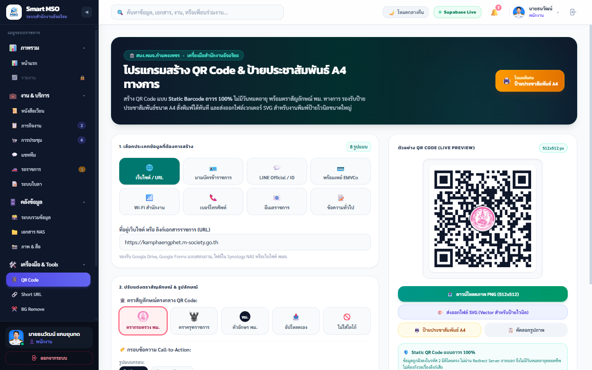
*ภาพที่ 26: เครื่องมือสร้าง Static QR Code ถาวร 100% (`/tools/qrcode`)*

1. **① เลือกประเภทข้อมูล QR 8 รูปแบบ & ใส่ข้อมูล:** รองรับลิงก์เว็บไซต์, ข้อความ, เบอร์โทร, อีเมล, Wi-Fi สำนักงาน, พิกัด GPS, นามบัตร vCard และลิงก์ภายใน Smart MSO
2. **② ปรับสี โลโก้กลางภาพ (ตรา พม. / ครุฑ) & ความละเอียด:** ปรับขนาด Error Correction, สีกรอบ/จุด และเลือกฝังโลโก้ราชการกลาง QR Code ได้ทันที
3. **③ ตัวอย่างสด, ส่งออก PNG/SVG & เปิดโหมดป้าย A4:** ตรวจสอบความพร้อมสแกน ดาวน์โหลด `PNG` หรือเวกเตอร์ `SVG` สำหรับงานพิมพ์ป้ายใหญ่ และกดปุ่ม **`🖨️ โหมดพิเศษ ป้ายประชาสัมพันธ์ A4`** (ภาพที่ 27)


*ภาพที่ 27: หน้าต่างออกแบบ **ป้ายประชาสัมพันธ์ขนาด A4 ทางการ** (Print-Ready A4 Signage)*

1. **① แก้ไขข้อความและเลือกชื่อหน่วยงานผู้จัดฝั่งซ้าย:** กรอก **`หัวข้อเอกสาร / ป้ายประกาศ *`** (เช่น เอกสารประกอบการประชุม), คำชี้แจง, เลือกหน่วยงานผู้จัด และข้อมูลติดต่อสำนักงาน
2. **② ตรวจความสวยงามบนกระดาษ A4 ตัวอย่าง (`Print-Ready`):** ด้านขวาจัดวาง **ตรากระทรวง พม.** ชื่อกรม/จังหวัด คำเชิญสแกน และกรอบ QR Code ขนาดใหญ่ตามสัดส่วนมาตรฐาน A4 ให้อัตโนมัติ
3. **③ กด **`📄 สร้าง PDF (A4)`** เพื่อสั่งพิมพ์ทันที:** ระบบสร้างไฟล์/คำสั่งพิมพ์ขนาด A4 พร้อมตั้งโต๊ะหรือติดหน้าห้องประชุมได้อย่างสวยงาม

### 4.2 ระบบย่อลิงก์ราชการอัจฉริยะ (Short URL)

เส้นทาง: `🛠️ เครื่องมือ & Tools` ➔ `🔗 Short URL` (`/tools/shorturl`)

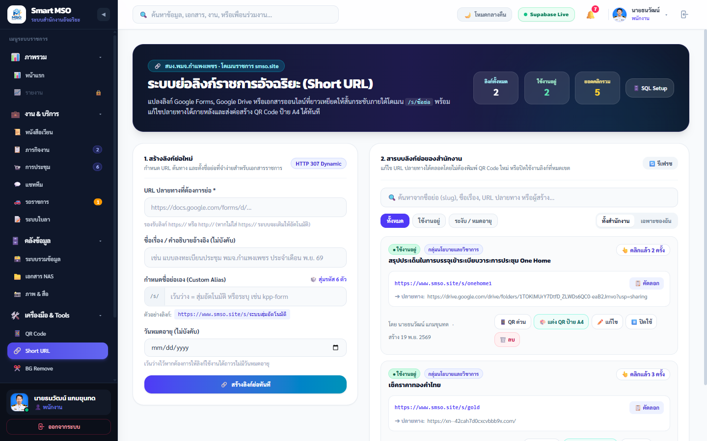
*ภาพที่ 28: ระบบย่อลิงก์ราชการอัจฉริยะ (`/tools/shorturl`) ภายใต้โดเมน `https://www.smso.site/s/...`*

1. **① วางลิงก์ปลายทาง & ตั้งชื่อย่อที่จำง่าย (Custom Alias):** เช่น แปลงลิงก์ Google Form ยาวๆ ให้เป็น `smso.site/s/survey69` เพิ่มความน่าเชื่อถือและลดโอกาสคลิกลิงก์ปลอม
2. **② ส่งต่อสร้าง QR Code / ป้าย A4 ทันที:** เชื่อมลิงก์ย่อไปยังเครื่องมือ QR Code ได้ในคลิกเดียว
3. **③ สถิติยอดคลิก & จัดการลิงก์:** ตรวจสอบจำนวนการเข้าถึงลิงก์ คัดลอก แก้ไขปลายทาง หรือปิดการใช้งานลิงก์ที่หมดเขตแล้ว

### 4.3 ระบบลบพื้นหลัง & ปรับแต่งรูปติดบัตรข้าราชการ (100% Client-side)

เส้นทาง: `🛠️ เครื่องมือ & Tools` ➔ `✂️ BG Remove` (`/tools/bgremove`)

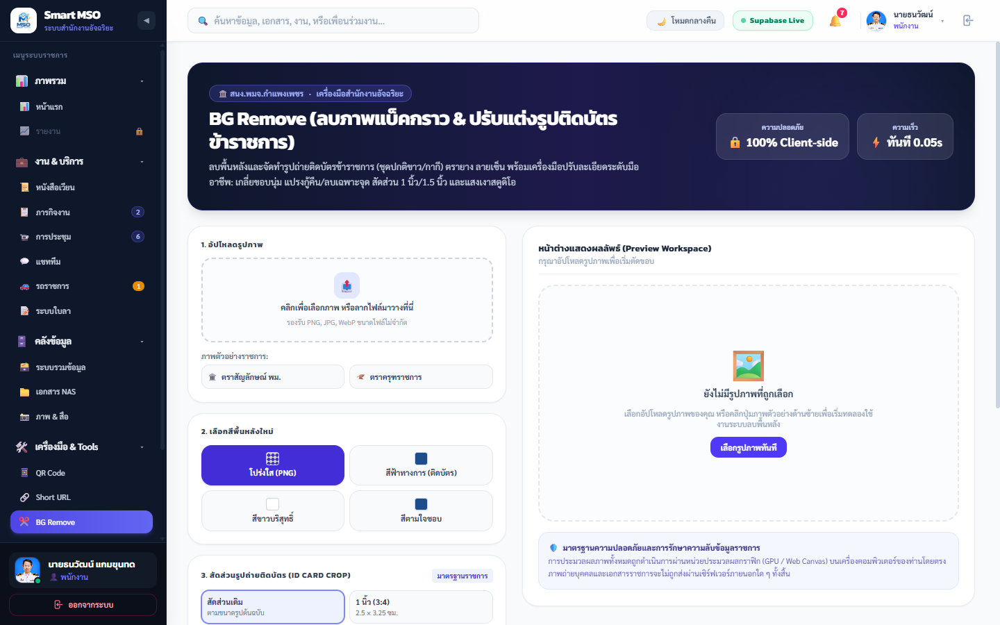
*ภาพที่ 29: หน้าตั้งค่าระบบลบพื้นหลัง Client-side (`/tools/bgremove`)*

1. **① อัปโหลดรูปภาพหรือทดสอบด้วยปุ่มตัวอย่าง:** ลากวางรูปภาพจากเครื่อง (JPG/PNG/WebP) หรือคลิกปุ่มตัวอย่าง **`🏛️ ตราสัญลักษณ์ พม.`** / **`📜 ตราครุฑราชการ`**
2. **② เลือกสีพื้นหลังใหม่ (`โปร่งใส PNG` / `สีฟ้าทางการ` / `สีขาว`):** เตรียมภาพตราองค์กรโปร่งใสสำหรับวางทับเอกสาร หรือเปลี่ยนฉากหลังสีฟ้ามาตรฐานรูปติดบัตร
3. **③ เลือกสัดส่วนรูปติดบัตรข้าราชการ (`1 นิ้ว / 1.5 นิ้ว / 2 นิ้ว`):** ครอปภาพตามมาตรฐานบัตรประจำตัวเจ้าหน้าที่รัฐ

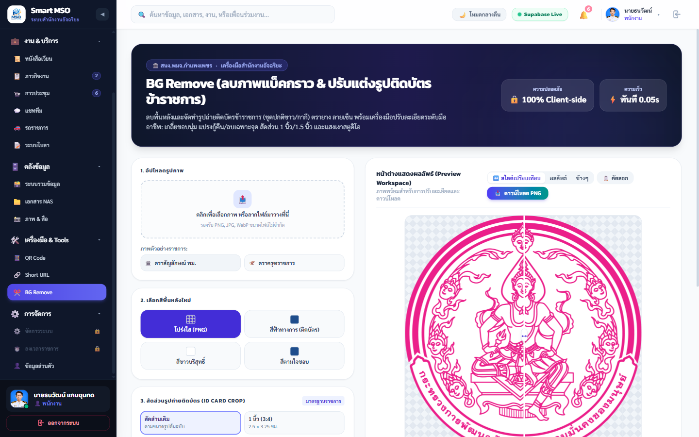
*ภาพที่ 30: ตัวอย่างผลลัพธ์หลังกด `🏛️ ตราสัญลักษณ์ พม.` แสดงสไลด์เปรียบเทียบต้นฉบับ ↔ ตัดขอบแล้ว*

1. **① ประมวลผลตัดพื้นหลังทันทีในเสี้ยววินาที (`⚡ 0.05s`):** ประมวลผลผ่าน HTML5 Web Canvas บนเบราว์เซอร์ 100% โดยไม่อัปโหลดภาพขึ้นเซิร์ฟเวอร์ภายนอก
2. **② สลับโหมดเปรียบเทียบ คัดลอก หรือดาวน์โหลด PNG:** เลือกโหมด `สไลด์เปรียบเทียบ`, `ผลลัพธ์`, `ข้างๆ` แล้วคลิก **`📋 คัดลอก`** หรือ **`📥 ดาวน์โหลด PNG`**
3. **③ เลื่อนแกนกลาง (`↔`) ตรวจความคมชัดของขอบภาพ:** ลากเส้นแบ่งเทียบ `ต้นฉบับ` กับ `ตัดขอบแล้ว` (ตารางหมากรุก = โปร่งใส)

### 4.4 ข้อมูลส่วนตัว การตั้งค่าแจ้งเตือน ธีม และรหัสผ่าน Synology NAS

เส้นทาง: `⚙️ การจัดการ` ➔ `👤 ข้อมูลส่วนตัว` (`/user`)

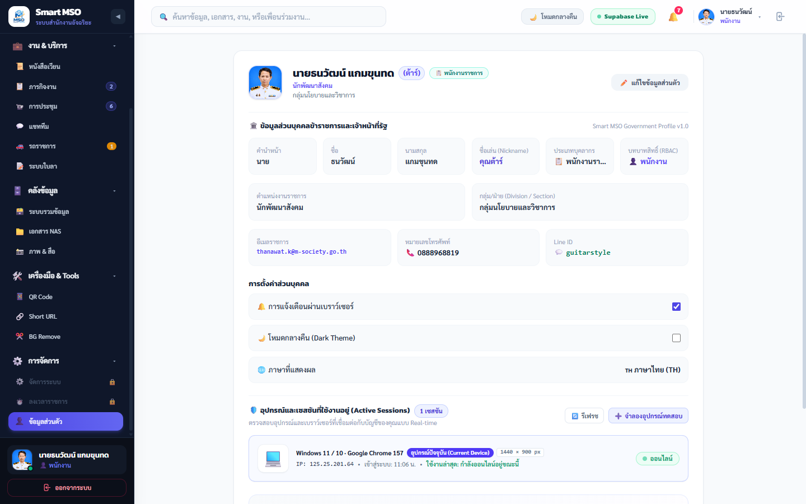
*ภาพที่ 31: หน้าข้อมูลส่วนตัวและตั้งค่าความปลอดภัยบัญชี (`/user`)*

1. **① ข้อมูลบัญชีผู้ใช้ & บทบาท RBAC:** ตรวจสอบชื่อ ตำแหน่ง กลุ่มงานสังกัด และสิทธิ์เข้าถึงโมดูลปัจจุบัน
2. **② ตั้งค่าธีม การแจ้งเตือน & Active Sessions:** สลับโหมดสว่าง/มืด เปิด-ปิดแจ้งเตือนรายหมวด เปิดรับ Web Push Notification และสั่งเคลียร์ Session จากเครื่องอื่นหากลืมออกจากระบบ
3. **③ อัปเดตรหัสผ่านระบบ & รหัสเชื่อม Synology NAS:** เปลี่ยนรหัสผ่านหรืออัปเดตข้อมูลเชื่อมต่อบัญชี NAS ส่วนตัวได้อย่างปลอดภัย

### 4.5 วิเคราะห์จุดเด่น เว็บภายนอก vs Smart MSO, ฟังก์ชันพิเศษ & คำแนะนำพิเศษ (บทที่ 4)

| ประเด็นเปรียบเทียบ | วิธีเดิม (ใช้เว็บฟรีภายนอกหลายเว็บ) | เครื่องมือใน Smart MSO (Tools Suite) | ประโยชน์หลักที่สำนักงานได้รับ |
| :--- | :--- | :--- | :--- |
| **การสร้าง QR Code & ย่อลิงก์** | ใช้เว็บฟรีภายนอกที่มักจำกัดวันหมดอายุ แทรกโฆษณา หรือลิงก์โดเมนแปลกปลอมเสี่ยงฟิชชิง | **Static QR 100% ถาวร** ไม่มีวันหมดอายุ + **Short URL โดเมน `.smso.site/s/...`** | QR พิมพ์ติดป้าย/บอร์ดถาวรไม่เสียกลางทาง และประชาชนเชื่อมั่นว่าเป็นลิงก์ทางการของ พมจ. |
| **การทำป้าย QR ประชาสัมพันธ์ A4** | ต้องนำ QR ไปเปิด Word/Canva จัดหน้า วางตรา พม. เองทุกครั้ง เสียเวลามาก | โหมดพิเศษ **ป้ายประชาสัมพันธ์ขนาด A4 ทางการ** จัดหน้าพร้อมตรา พม. และปุ่มสร้าง PDF ทันที | เจ้าหน้าที่ทุกคนทำป้าย A4 สวยงามมาตรฐานเดียวกับกลุ่มวิชาการได้ภายใน 30 วินาที |
| **การลบพื้นหลัง & รูปติดบัตร** | ต้องส่งรูปบัตรประชาชน/รูปข้าราชการขึ้นเว็บต่างประเทศ เสี่ยงข้อมูลรั่วไหลหรือติดลายน้ำ | **BG Remove 100% Client-side** ประมวลผลในเบราว์เซอร์ ไม่ส่งรูปออกนอกเครื่อง (`PDPA Safe`) | ปลอดภัยสูงสุด ประมวลผลเร็ว (`0.05s`) และมีตรา พม./ครุฑสำเร็จรูปพร้อมครอปรูป ก.พ. |

- **✨ ฟังก์ชันพิเศษเฉพาะสำนักงาน:** `Print-Ready A4 QR Signage Generator`, `โดเมนย่อลิงก์ทางการ smso.site/s/`, และ `Browser Client-side BG Remove & รูปติดบัตร ก.พ.`
- **💡 คำแนะนำพิเศษ (Pro Tips):** จับคู่ **`Short URL`** ก่อนนำลิงก์มาทำ **`QR Code`** เพื่อให้รหัส QR โล่ง สแกนง่ายแม้พิมพ์ขนาดเล็ก และสามารถแก้ลิงก์ปลายทางใน Short URL ได้โดยไม่ต้องพิมพ์ QR ใหม่; ใช้โหมด **SVG** เมื่อต้องการส่งโรงพิมพ์ทำป้ายไวนิล

---

## บทที่ 5: ระบบสิทธิ์การใช้งาน (RBAC) และโมดูลจำกัดสิทธิ์ (🔒)

### 5.1 เมทริกซ์สิทธิ์ทั้ง 17 โมดูล × 4 บทบาท (`lib/rbac.ts`)

ระบบควบคุมการเข้าถึงตามบทบาท (**RBAC — Role-Based Access Control**) กำหนดค่ามาตรฐานผ่าน `INITIAL_ROLE_PERMISSIONS` ใน `lib/rbac.ts` ดังนี้ (`👑 Admin: 17/17`, `👔 Manager: 15/17`, `👤 Member: 14/17`, `🎟️ Guest: 6/17`):

| # | โมดูลระบบ (Module) | เส้นทาง (`Route`) | Admin (17/17) | Manager (15/17) | Member (14/17) | Guest (6/17) |
| :---: | :--- | :--- | :---: | :---: | :---: | :---: |
| 1 | 📊 หน้าแรก (Dashboard) | `/dashboard` | ✓ | ✓ | ✓ | 🔒 |
| 2 | 💬 แชททีม (Chat) | `/chat` | ✓ | ✓ | ✓ | ✓ |
| 3 | 📜 หนังสือเวียน (Circular) | `/circular` | ✓ | ✓ | ✓ | 🔒 |
| 4 | 📋 ภารกิจงาน (Tasks) | `/tasks` | ✓ | ✓ | ✓ | 🔒 |
| 5 | 📹 การประชุม (Meetings) | `/meetings` | ✓ | ✓ | ✓ | ✓ |
| 6 | 🚗 รถราชการ (Car Booking) | `/carbooking` | ✓ | ✓ | ✓ | 🔒 |
| 7 | 📝 ระบบใบลา (Leave) | `/leave` | ✓ | ✓ | ✓ | 🔒 |
| 8 | 🗃️ ระบบรวมข้อมูล (Data Hub) | `/data-hub` | ✓ | ✓ | ✓ | 🔒 |
| 9 | 📁 เอกสาร NAS (File Station) | `/files` | ✓ | ✓ | ✓ | 🔒 |
| 10 | 📸 ภาพ & สื่อ (Synology Photos) | `/gallery` | ✓ | ✓ | ✓ | 🔒 |
| 11 | 📱 QR Code ถาวร | `/tools/qrcode` | ✓ | ✓ | ✓ | ✓ |
| 12 | 🔗 Short URL ย่อลิงก์ | `/tools/shorturl` | ✓ | ✓ | ✓ | ✓ |
| 13 | ✂️ BG Remove ลบพื้นหลัง | `/tools/bgremove` | ✓ | ✓ | ✓ | ✓ |
| 14 | 👤 ข้อมูลส่วนตัว (Profile) | `/user` | ✓ | ✓ | ✓ | ✓ |
| 15 | 📈 รายงาน (Reports) | `/reports` | ✓ | ✓ | 🔒 | 🔒 |
| 16 | ⏱️ ลงเวลาราชการ (Attendance) | `/attendance` | ✓ | `⚠️*` | 🔒 | 🔒 |
| 17 | ⚙️ จัดการระบบ (Admin Panel) | `/admin` | ✓ | 🔒 | 🔒 | 🔒 |

> **หมายเหตุ:** `✓` = เข้าใช้งานได้ตามสิทธิ์มาตรฐาน · `🔒` = ไม่มีสิทธิ์เข้าถึงตามบทบาทเริ่มต้น · `⚠️*` (`/attendance`) = เข้าถึงได้เฉพาะ `Admin` หรือผู้ที่ได้รับการกำหนดสิทธิ์ในรายชื่อผู้แก้ไขลงเวลา (`Authorized Editors`) โดยตรง

### 5.2 รายละเอียด 3 โมดูลจำกัดสิทธิ์ (`🔒` สำหรับบทบาท Member)

1. **`📈 รายงาน (Reports & Analytics)` (`/reports`) — สิทธิ์: Admin & Manager**  
   - **แดชบอร์ดคำนวณสด (`Live Computed`):** สรุปสถิติจาก Supabase Realtime 4 มิติ ได้แก่ อัตราความสำเร็จงาน Kanban, สถิติการประชุม (ออนไลน์/ออนไซต์), คำขอใช้รถราชการ, และงบค่าน้ำมันสะสม  
   - **ส่งออกรายงานทางราชการ:** รองรับ **`📊 ส่งออก CSV (สตง.)`** และ **`📑 ส่งออก PDF`**
2. **`⏱️ ลงเวลาราชการ (Attendance Management)` (`/attendance`) — สิทธิ์: Admin หรือ Authorized Editors**  
   - **สถาปัตยกรรม Hybrid 3 ฐานข้อมูล:** เชื่อมเครื่องสแกนลายนิ้วมือ **`HIP CMi681S`** ↔ **`MariaDB บน Synology NAS`** ↔ **`Supabase Cloud`** รองรับโหมด **`☁️ Cloud Replica`** และ **Remote Sync Queue**  
   - **2 มุมมอง & ส่งออก 3 ฟอร์แมต:** `📋 รายการบันทึกเวลาทั้งหมด` และ `📊 รายงานประจำวัน (ID 2–42)` แยก 2 ชุดมาตรฐาน (`1. ขรก./พรก.` และ `2. พนง.กองทุน/จ้างเหมา`) พร้อมส่งออก **`.xlsx` (2 ชีท) / `.docx` / `.pdf (A4)`** และหน้าต่างจับคู่รหัสสแกน (`User ID`)
3. **`⚙️ จัดการระบบ (Admin Panel)` (`/admin`) — สิทธิ์: Admin เท่านั้น**  
   - **ศูนย์ควบคุม 10 แท็บครบวงจร:** `👥 สมาชิก & สิทธิ์`, `📬 คำขอสิทธิ์ใหม่`, `🔒 กำหนดสิทธิ์ (RBAC Matrix)`, `💬 ห้องสื่อสารองค์กร`, `🚗 ยานพาหนะราชการ`, `🏛️ ห้องประชุม & สถานที่`, `🏢 โครงสร้างกลุ่มงาน`, `📜 ทะเบียนหนังสือเวียน`, `📜 Audit Logs`, และ `💾 Synology NAS`

### 5.3 วิเคราะห์จุดเด่น สมุดลงเวลาเดิม vs RBAC + Hybrid Attendance & คำแนะนำพิเศษ (บทที่ 5)

| ประเด็นเปรียบเทียบ | ระบบเดิม (ดึงไฟล์จากเครื่อง/จัดมือ) | ระบบ Smart MSO (Hybrid + RBAC) | ประโยชน์หลักที่สำนักงานได้รับ |
| :--- | :--- | :--- | :--- |
| **การจัดเก็บเวลาสแกนนิ้ว** | ต้องดึงไฟล์จากเครื่องสแกนด้วย LAN/USB แล้วมาจัดคอลัมน์ใน Excel ทุกเช้าทีละชุด | ซิงก์ตรงจากเครื่อง `HIP CMi681S` ลง MariaDB NAS + Supabase พร้อมออก Excel/Word/PDF 2 ชุดทันที | ลดงานธุรการประจำวันลงกว่า 80% และรองรับดูย้อนหลังแบบ Cloud Replica |
| **การสรุปรายงานผู้บริหาร** | รวบรวมตัวเลขงาน ประชุม และค่าน้ำมันจากหลายไฟล์/หลายฝ่ายกว่าจะสรุปได้ใช้เวลาหลายวัน | หน้า `/reports` คำนวณสดแบบ Realtime จากฐานข้อมูล พร้อมปุ่มส่งออก `CSV (สตง.) / PDF` | ผู้บริหารเห็นตัวเลขจริงทันเหตุการณ์ ไม่มีข้อมูลตกหล่นหรือคลาดเคลื่อน |
| **การควบคุมสิทธิ์ & ตรวจสอบ** | ไม่มีระบบ Audit Log บันทึกว่าใครเปิดดู แก้ไข หรือปฏิเสธคำขอใด เมื่อไร | `RBAC Matrix 4 บทบาท` แยกสิทธิ์ 17 โมดูลชัดเจน พร้อม `Audit Logs` ตรวจสอบย้อนหลังได้ | ยกระดับธรรมาภิบาลและความปลอดภัยสารสนเทศตามมาตรฐานหน่วยงานรัฐ |

- **✨ ฟังก์ชันพิเศษเฉพาะสำนักงาน:** `Hybrid 3-DB Attendance + Remote Sync Queue`, `ส่งออกรายงานเวลาประจำวัน 2 ชุด (ID 2–42) 3 ฟอร์แมต`, และ `Admin Control Center 10 แท็บ & Dynamic RBAC Matrix`
- **💡 คำแนะนำพิเศษ (Pro Tips):** เจ้าหน้าที่ใหม่ควรแจ้งธุรการจับคู่รหัสสแกนนิ้ว (`User ID`) ทันทีเพื่อให้หน้า `/leave` แสดงสถานะเชื่อมเครื่องสแกนนิ้ว; ฝ่ายบริหารสามารถขอสิทธิ์ `Authorized Editor` เฉพาะหน้า `/attendance` โดยไม่ต้องเปิดสิทธิ์ Admin ทั้งระบบ

---

## บทที่ 6: การแก้ไขปัญหาเบื้องต้น Checklist & สรุปความคุ้มค่าองค์กร

### 6.1 ตารางอาการที่พบบ่อยและแนวทางแก้ไขเบื้องต้น (FAQ)

| อาการที่พบ / สถานการณ์ | สาเหตุและแนวทางแก้ไขเบื้องต้น |
| :--- | :--- |
| **หน้าเข้าสู่ระบบค้างที่การตรวจสอบ Turnstile** | รีเฟรชหน้าเว็บ 1 ครั้ง ปิดส่วนขยายบล็อกสคริปต์/VPN ชั่วคราว หรือใช้ LAN สำนักงานเพื่อให้ระบบสลับสู่ Synology DSM Fallback อัตโนมัติ |
| **ตัวเลขบนหน้า Dashboard หรือ Kanban ไม่อัปเดต** | ตรวจสอบป้ายสถานะด้านบนว่าเป็น `🟢 Supabase Live` หรือไม่ หากแสดงสีส้ม/แดงให้กดรีเฟรชหน้า (`F5`) |
| **เมนูบางรายการแสดงไอคอนแม่กุญแจ `🔒` (เช่น รายงาน / ลงเวลา / Admin)** | เป็นไปตามนโยบายสิทธิ์ `RBAC Matrix` ของบัญชีระดับ `Member` หากต้องการสิทธิ์เพิ่มให้ติดต่อผู้ดูแลระบบประจำสำนักงาน |
| **เข้าดูไฟล์ใน `เอกสาร NAS` หรือ `ภาพ & สื่อ` ไม่ได้** | ตรวจสอบรหัสผ่านบัญชี DSM ในหน้า `👤 ข้อมูลส่วนตัว` (`/user`) หรือแจ้งผู้ดูแลระบบตรวจสอบสิทธิ์ DSM ACL ของโฟลเดอร์แชร์ |
| **หน้า `/leave` ไม่ขึ้นป้าย `🔗 เชื่อมเครื่องสแกนนิ้วแล้ว`** | แจ้งผู้ดูแลระบบหรือฝ่ายบริหารทั่วไปให้ผูก **User ID เครื่องสแกน HIP CMi681S** ให้ตรงกับบัญชีผู้ใช้ Smart MSO |

### 6.2 แนวทางปฏิบัติงานดิจิทัลประจำวัน (Daily Operational Checklist)

- **1. ช่วงเช้า (เปิดระบบ & แจ้งเตือน):** ล็อกอิน `https://www.smso.site` ตรวจกระดิ่ง **`🔔 แจ้งเตือน`**, เช็กหนังสือเวียนด่วน (`📜 หนังสือเวียน`) และตารางนัดประชุม (`📹 การประชุม`)
- **2. ระหว่างวัน (ประสานงาน & ลงพื้นที่):** อัปเดตสถานะงานบน **`📋 ภารกิจงาน`**, จองรถแบบ พมจ.กพ 02 ใน **`🚗 รถราชการ`**, สื่อสารและแนบไฟล์ผ่าน **`💬 แชททีม`**
- **3. สารบรรณ & สื่อ (จัดเก็บ & เผยแพร่):** เก็บเอกสารสำคัญใน **`📁 เอกสาร NAS`**, ภาพกิจกรรมลง **`📸 ภาพ & สื่อ`**, สร้างลิงก์ **`Short URL`** + ป้าย A4 จาก **`📱 QR Code`**

### 6.3 วิเคราะห์ความคุ้มค่าภาพรวมทั้งระบบ & ฟังก์ชันเชื่อมข้ามโมดูล

| ประเด็นเปรียบเทียบ | สำนักงานกระดาษแบบเดิม | Smart MSO Virtual Office | ประโยชน์รวมต่อ พมจ.กำแพงเพชร |
| :--- | :--- | :--- | :--- |
| **ต้นทุนทรัพยากรสำนักงาน** | สิ้นเปลืองกระดาษ หมึกพิมพ์ แฟ้มเอกสาร และพื้นที่ตู้เก็บจำนวนมากทุกปี | ลดกระดาษในหนังสือเวียน ใบลา คำขอรถ และการค้นหาคำสั่ง เก็บบน Hybrid Cloud + NAS | ประหยัดงบวัสดุสำนักงานและลดเวลาเดินแฟ้มข้ามกลุ่มงานอย่างชัดเจน |
| **ความต่อเนื่องเมื่อลงพื้นที่ 11 อำเภอ** | อยู่นอกสำนักงานแล้วเปิดไฟล์คำสั่ง จองรถ หรืออนุมัติเอกสารไม่ได้ | ใช้งานได้ทุกที่ผ่าน `https://www.smso.site` ทั้ง PC และมือถือ | ผู้บริหารอนุมัติงานทันเหตุการณ์ ทีมภาคสนามเปิดดูข้อมูล TPMAP / แบบฟอร์มได้ทันที |
| **ความเชื่อมโยงระหว่างข้อมูล** | ข้อมูลแต่ละฝ่ายแยกส่วน (`Silo`) ต้องคีย์ซ้ำหลายรอบ | ข้อมูลเชื่อมเป็นเครือข่ายเดียว (**ใบลา ➔ ลงเวลา**, **แชท ➔ NAS**, **Short URL ➔ ป้าย QR A4**) | **Single Source of Truth** ข้อมูลชุดเดียวสอดคล้องกันทั้งสำนักงาน |

---

## บทที่ 7: แนวทางการพัฒนาระบบในอนาคต (HRM & CRM Roadmap) & เครดิตผู้พัฒนา

เพื่อต่อยอดรากฐานของ Smart MSO (17 โมดูล + Synology NAS + ข้อมูล TPMAP 11 อำเภอ 78 ตำบล) ให้ตอบโจทย์ **แผนยุทธศาสตร์รัฐบาลดิจิทัล 4.0** อย่างสมบูรณ์ ระบบมีแผนพัฒนาต่อเนื่องใน 2 แกนหลัก ได้แก่ **CRM (การดูแลประชาชนและกลุ่มเปราะบาง)** และ **HRM (การบริหารทรัพยากรบุคคลดิจิทัล)**:

### 7.1 แนวทางต่อยอดด้าน CRM เพื่อประชาชนและกลุ่มเปราะบาง

1. **🏡 ระบบเยี่ยมบ้านออนไลน์ (`Home Visit Online`)**
   - **แบบบันทึกเยี่ยมบ้านภาคสนาม (`Mobile-Ready`):** นักพัฒนาสังคม/นักสังคมสงเคราะห์ บันทึกแบบประเมินสภาพความเป็นอยู่ ปัญหา 5 มิติ และความต้องการช่วยเหลือจากหน้างานผ่านสมาร์ตโฟนได้ทันที
   - **ปักหมุดพิกัด GPS & ภาพถ่ายลงพื้นที่อัตโนมัติ:** ระบุตำแหน่งครัวเรือนเป้าหมายบนแผนที่จังหวัดกำแพงเพชร เก็บภาพ Before–After บน `Synology NAS` พร้อมแผนที่ความร้อน (Heatmap) ครบ 11 อำเภอ 78 ตำบล
   - **เชื่อมโยงฐานข้อมูล TPMAP & ศรส. 1300:** ดึงรายชื่อครัวเรือนตกเกณฑ์ จปฐ. จากแท็บ TPMAP มาเปิดเคสติดตามเยี่ยมบ้านต่อเนื่องจนพ้นเกณฑ์ความเปราะบาง
2. **🩺 คลินิกทางสังคมออนไลน์ (`Online Social Clinic`)**
   - **นัดหมายคิว & ให้คำปรึกษาทางไกล (`Tele-Counseling`):** เปิดช่องทางให้ประชาชนหรือเครือข่าย อพม. จองเวลาขอรับคำปรึกษาปัญหาครอบครัว เด็ก เยาวชน สตรี ผู้สูงอายุ และคนพิการผ่านวิดีโอคอล/แชทที่ปลอดภัย
   - **ระบบส่งต่อเคสสหวิชาชีพ (`Multi-Disciplinary Referral`):** ส่งต่อคำร้องและแฟ้มประวัติเคสระหว่าง *นักสังคมสงเคราะห์ — นิติกร — นักจิตวิทยา — ศูนย์บริการคนพิการ* พร้อมบันทึกความก้าวหน้าครบวงจร
   - **คุ้มครองข้อมูลส่วนบุคคล (`PDPA Consent & Confidential RBAC`):** เข้ารหัสและจำกัดสิทธิ์การเข้าถึงข้อมูลกลุ่มเปราะบางตามระดับบทบาทหน้าที่อย่างเคร่งครัด
3. **🤝 ฐานข้อมูลสวัสดิการแบบ 360 องศา & เครือข่าย อพม. 11 อำเภอ**
   - บูรณาการประวัติการรับสิทธิสวัสดิการทุกประเภทเข้าด้วยกัน (ลดการช่วยเหลือซ้ำซ้อน/ตกหล่น) พร้อมช่องทางให้ อาสาสมัครพัฒนาสังคมและความมั่นคงของมนุษย์ (อพม.) รายงานเคสเร่งด่วนเข้าสู่ศูนย์ปฏิบัติการ พมจ. แบบเรียลไทม์

### 7.2 แนวทางต่อยอดด้าน HRM (ระบบบริหารทรัพยากรบุคคลดิจิทัล)

- **🪪 แฟ้มประวัติบุคลากรดิจิทัล (`Digital e-Profile`):** รวบรวมคำสั่งบรรจุ แต่งตั้ง เลื่อนระดับ ประวัติฝึกอบรม และเอกสาร ก.พ. 7 ออนไลน์ พร้อมแจ้งเตือนวันครบกำหนดสัญญาจ้าง
- **📚 แผนพัฒนาทักษะรายบุคคล (`IDP & Training Tracker`):** บันทึกชั่วโมงอบรมรายปี ขออนุมัติไปราชการ/สัมมนา และจัดเก็บเกียรติบัตรดิจิทัลบน Synology NAS ประจำตัวบุคคล
- **📊 ประเมินผลการปฏิบัติงานรอบ 6 เดือน (`KPI Automation`):** ดึงสถิติตรงจาก **ลงเวลาราชการ (`HIP CMi681S`) + วันลาที่อนุมัติ + ความสำเร็จงาน Kanban** มาสรุปผลประเมินรอบ 6 เดือนอย่างเป็นธรรมและโปร่งใส

### 7.3 แผนการพัฒนา 3 ระยะ & วิเคราะห์ความคุ้มค่าในอนาคต

```
[Phase 1 (ปัจจุบัน): Smart Virtual Office] ➔ [Phase 2 (ระยะกลาง): Field CRM & Online Clinic] ➔ [Phase 3 (ระยะยาว): Unified HRM & AI Hub]
   (17 โมดูลหลัก + NAS + TPMAP 78 ตำบล)         (เยี่ยมบ้าน Online + คลินิกทางสังคม + อพม.)        (ประเมินผล 6 ด. + วิเคราะห์พยากรณ์กลุ่มเปราะบาง)
```

---

### เกียรติคุณและเครดิตผู้พัฒนาระบบ (System Architect & Developer Credit)

> **พัฒนาและออกแบบระบบรวมถึงจัดทำเอกสารคู่มือมาตรฐานฉบับนี้โดย:**  
> **นายธนวัฒน์ แกมขุนทด**  
> **ตำแหน่งนักพัฒนาสังคม · กลุ่มนโยบายและวิชาการ**  
> สำนักงานพัฒนาสังคมและความมั่นคงของมนุษย์จังหวัดกำแพงเพชร  
> กระทรวงการพัฒนาสังคมและความมั่นคงของมนุษย์  
> ระบบใช้งานจริง: <https://www.smso.site> | รหัสเอกสาร: `MSO-KPP-UM-002` (ฉบับที่ 2.0)
